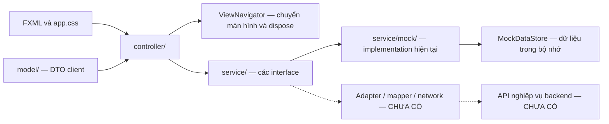
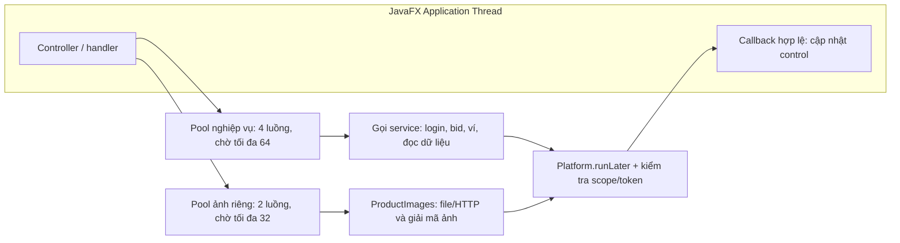
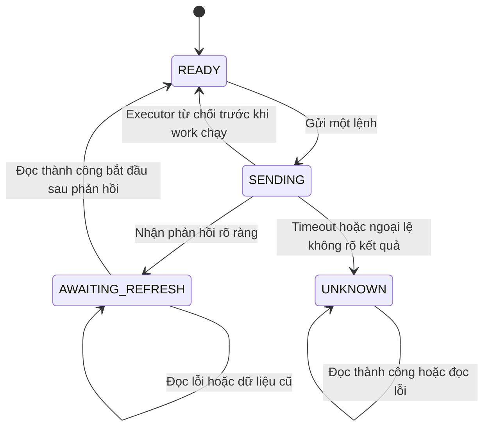

# Client JavaFX — Digital Auction

## 1. Client dùng để làm gì?

Đây là ứng dụng desktop để đăng nhập/đăng ký, tìm phiên đấu giá, xem sản phẩm, đặt giá và theo dõi lịch sử/biểu đồ. Người bán có trang quản lý sản phẩm; quản trị viên có trang người dùng/phiên. Ví và auto-bid hiện là chức năng mô phỏng.

**Thành viên 3** phụ trách FXML/CSS, controller, model/DTO phía client, điều hướng, vòng đời màn hình và nối UI với hợp đồng dịch vụ. Controller không giữ socket và không thay backend quyết định một giá có được nhận hay không.

Công nghệ thực tế: Java release **25**, JavaFX **26.0.2**, Maven và JUnit Jupiter **6.1.3** theo [pom.xml](pom.xml). Giữ kiến trúc Client–Server + MVC: FXML/CSS là View; controller xử lý tương tác; model giữ dữ liệu; service là ranh giới với nguồn dữ liệu.

**Tình trạng hiện tại: tất cả nghiệp vụ chạy bằng mock trong bộ nhớ; chưa có adapter nghiệp vụ server thật.** Server được đọc để đối chiếu chỉ có echo chuỗi `readUTF/writeUTF` ở cổng 8888, chưa có handler xác thực/đặt giá/lịch sử/broadcast. Cấu hình `auction.mode=server` báo chưa hỗ trợ, không tự chuyển sang mock.

## 2. Cây thư mục thực tế

Cây dưới đây chỉ liệt kê source, resource, cấu hình, scripts và tài liệu. Không có file sinh từ Maven hoặc dependency tải về.

```text
auction-client-ui/
├── docs/
│   ├── ui/
│   │   ├── refresh-2026-11-03/       Ảnh mới: wide/, narrow/, đăng ký cuộn và lưới tám phiên
│   │   ├── screenshots/
│   │   │   ├── 01_auth_login.png
│   │   │   ├── 02_auth_register.png
│   │   │   ├── 03_dashboard.png
│   │   │   ├── 04_realtime_bidding_running.png
│   │   │   ├── 05_realtime_bidding_finished.png
│   │   │   ├── 06_product_management.png
│   │   │   ├── 07_uikit_showcase.png
│   │   │   └── 08_icon_gallery.png
│   │   ├── DESIGN-apple.md
│   │   ├── DESIGN.md
│   │   └── PROMPT_FIX_UI_1.md
│   ├── CLIENT_HANDOVER.md
│   ├── CODE_MAP.md
│   ├── DEV_ACCOUNTS.md
│   ├── IMAGE_CREDITS.md
│   ├── UI_REFRESH.md
│   └── VALIDATION.md
├── scripts/
│   ├── check-contrast.py
│   ├── check-docs.py
│   └── check-encoding.py
├── src/
│   ├── main/
│   │   ├── java/
│   │   │   ├── com/
│   │   │   │   └── auction/
│   │   │   │       └── client/
│   │   │   │           ├── controller/
│   │   │   │           │   ├── AdminController.java
│   │   │   │           │   ├── AuctionRoomController.java
│   │   │   │           │   ├── AuthController.java
│   │   │   │           │   ├── ContactController.java
│   │   │   │           │   ├── GuideController.java
│   │   │   │           │   ├── HomeController.java
│   │   │   │           │   ├── SellerProductsController.java
│   │   │   │           │   └── WalletController.java
│   │   │   │           ├── dev/
│   │   │   │           │   ├── SnapshotApp.java
│   │   │   │           │   └── UiKitController.java
│   │   │   │           ├── model/
│   │   │   │           │   ├── AdminUser.java
│   │   │   │           │   ├── Auction.java
│   │   │   │           │   ├── AuctionStatus.java
│   │   │   │           │   ├── AutoBid.java
│   │   │   │           │   ├── Bid.java
│   │   │   │           │   ├── Item.java
│   │   │   │           │   ├── ItemCategory.java
│   │   │   │           │   ├── Transaction.java
│   │   │   │           │   ├── TransactionType.java
│   │   │   │           │   ├── User.java
│   │   │   │           │   └── UserRole.java
│   │   │   │           ├── navigation/
│   │   │   │           │   ├── DisposableView.java
│   │   │   │           │   ├── ViewNavigator.java
│   │   │   │           │   └── ViewTasks.java
│   │   │   │           ├── service/
│   │   │   │           │   ├── mock/
│   │   │   │           │   │   ├── AutoBidEngine.java
│   │   │   │           │   │   ├── MockAuctionClientService.java
│   │   │   │           │   │   ├── MockAutoBidService.java
│   │   │   │           │   │   ├── MockDataStore.java
│   │   │   │           │   │   ├── MockManagementService.java
│   │   │   │           │   │   └── MockWalletService.java
│   │   │   │           │   ├── AuctionAdminService.java
│   │   │   │           │   ├── AuctionClientService.java
│   │   │   │           │   ├── AutoBidException.java
│   │   │   │           │   ├── AutoBidService.java
│   │   │   │           │   ├── BidResult.java
│   │   │   │           │   ├── BidSubmissionTracker.java
│   │   │   │           │   ├── ProductService.java
│   │   │   │           │   ├── ServiceRegistry.java
│   │   │   │           │   ├── UserAdminService.java
│   │   │   │           │   ├── WalletException.java
│   │   │   │           │   └── WalletService.java
│   │   │   │           ├── ui/
│   │   │   │           │   ├── AppFooter.java
│   │   │   │           │   ├── AppHeader.java
│   │   │   │           │   ├── Icons.java
│   │   │   │           │   ├── PasswordFieldWithToggle.java
│   │   │   │           │   ├── ProductImages.java
│   │   │   │           │   ├── RoundedClip.java
│   │   │   │           │   ├── SmoothScroll.java
│   │   │   │           │   └── UserMenu.java
│   │   │   │           ├── util/
│   │   │   │           │   ├── AppInfo.java
│   │   │   │           │   ├── AuctionTime.java
│   │   │   │           │   ├── FormatUtil.java
│   │   │   │           │   └── Validators.java
│   │   │   │           ├── App.java
│   │   │   │           └── Main.java
│   │   │   └── module-info.java
│   │   └── resources/
│   │       └── com/
│   │           └── auction/
│   │               └── client/
│   │                   ├── css/
│   │                   │   └── app.css
│   │                   ├── dev/
│   │                   │   └── uikit-view.fxml
│   │                   ├── views/
│   │                   │   ├── admin-view.fxml
│   │                   │   ├── auction-room-view.fxml
│   │                   │   ├── auth-view.fxml
│   │                   │   ├── contact-view.fxml
│   │                   │   ├── guide-view.fxml
│   │                   │   ├── home-view.fxml
│   │                   │   ├── seller-products-view.fxml
│   │                   │   └── wallet-view.fxml
│   │                   └── contacts.properties
│   └── test/
│       └── java/
│           └── com/
│               └── auction/
│                   └── client/
│                       ├── controller/
│                       │   └── ClientUiTest.java
│                       ├── navigation/
│                       │   ├── ImageTasksTest.java
│                       │   └── ViewTasksTest.java
│                       ├── service/
│                       │   ├── BidSubmissionTrackerTest.java
│                       │   ├── MockAuctionBidAccessTest.java
│                       │   ├── MockAuthIntegrationTest.java
│                       │   ├── MockAutoBidServiceTest.java
│                       │   ├── MockManagementServiceTest.java
│                       │   ├── MockSharedStoreTest.java
│                       │   ├── MockWalletServiceTest.java
│                       │   └── ServiceRegistryTest.java
│                       ├── ui/
│                       │   ├── ProductImagesIoTest.java
│                       │   ├── ProductImagesTest.java
│                       │   └── UiResourcesTest.java
│                       └── util/
│                           ├── AuctionTimeTest.java
│                           ├── FormatUtilTest.java
│                           └── ValidatorsTest.java
├── pom.xml
└── README.md
```

Các nhóm nên đọc theo thứ tự khi mới học:

1. `Main.java` → `navigation/ViewNavigator.java`: cách khởi động và chuyển màn hình.
2. `views/auth-view.fxml` → `controller/AuthController.java`: cách `fx:controller`, `fx:id` và handler nối với nhau.
3. `service/AuctionClientService.java` → `service/mock/MockAuctionClientService.java`: interface khác implementation như thế nào.
4. `model/Auction.java`, `model/Bid.java` → `controller/AuctionRoomController.java`: dữ liệu đi lên biểu đồ/lịch sử.
5. `navigation/ViewTasks.java` và `service/BidSubmissionTracker.java`: công việc nền và khóa lệnh giá.

**Bảng chức năng từng file nằm ở [docs/CODE_MAP.md](docs/CODE_MAP.md).** Bảng bao phủ toàn bộ Java chính và test, từng FXML/CSS, `pom.xml`, `module-info.java`, properties và scripts; mỗi hàng ghi liên kết chính và tình trạng sử dụng. Cây thư mục không thay thế bảng này.

## 3. Các lớp nối với nhau như thế nào?

Nét liền là thành phần có thật. Nét đứt là phần cần xây dựng khi backend có hợp đồng; không phải chức năng đã tích hợp.



`ServiceRegistry` cấp các implementation hiện tại và một `BidSubmissionTracker` dùng chung. `setServices(...)` là điểm thay cả bộ dịch vụ sau này; thay riêng một adapter giữa các mock bị từ chối. Không gửi trực tiếp model client thay cho entity server chỉ vì cùng tên hoặc cùng `Serializable`.

### Ranh giới giữa các luồng

JavaFX chỉ cho cập nhật control trên **JavaFX Application Thread**. `ViewTasks.submit(...)` đưa công việc vào pool nền rồi gửi callback về bằng `Platform.runLater`; chỉ callback mới nhất của mỗi khóa và scope còn mở mới được áp dụng.



Không dùng chính sách chạy tác vụ trên UI khi hàng đợi đầy. `AbortPolicy` từ chối tác vụ; `ViewTasks.NotSubmittedException` đi vào callback lỗi để phục hồi nút/progress. Lỗi này chỉ có nghĩa **executor chưa nhận công việc**, khác lỗi phát sinh trong `placeBid` sau khi đã gửi.

- Scope nghiệp vụ `new ViewTasks()`: đóng màn hình chỉ chặn callback. Lệnh đã được nhận vẫn có thể chạy/xử lý xong; không hủy giao dịch và không tự gửi lại.
- Scope ảnh `ViewTasks.images()`: đổi khóa hoặc `cancelAll()` hủy Future cũ và bỏ công việc chờ khỏi hàng đợi. Home gọi khi đổi bộ lọc; mỗi ô bảng Seller có scope riêng và hủy khi tái sử dụng; Room/hộp thoại đóng scope khi rời.
- Ảnh HTTP có connect/read timeout 3 giây, kiểm tra deadline 10 giây giữa các lần đọc và đóng stream. Interrupt là best effort: một lần đọc đang chặn có thể cần chờ read timeout; decoder JavaFX đồng bộ không cung cấp bảo đảm dừng tức thì. Các giới hạn này không phải timeout cho một API đấu giá thật.
- Kết quả ảnh cũ không gắn sang card/ô mới. Khi tải ảnh lỗi hoặc hàng đợi đầy, card/ô giữ icon; form chọn ảnh báo lỗi và vẫn có thể thao tác lại.

## 4. Luồng đặt giá và kết quả chưa xác định

`bidBusy` biểu thị lượt gửi của màn hình, `refreshing` biểu thị lượt đọc dữ liệu đang chạy; `BidSubmissionTracker` giữ trạng thái lệnh theo **username + auctionId** qua các lần chuyển màn hình.



`READY` chỉ là điều kiện của lệnh: UI còn cần đăng nhập, phiên RUNNING chưa hết giờ, không phải sản phẩm của mình, có dữ liệu và không có lượt đọc/auto-bid đang chờ. Một lượt đọc thông thường cũng tạm khóa các thao tác giá cho đến khi nhận dữ liệu.

Luồng cụ thể:

1. Người dùng nhập tiền rồi bấm Đặt giá hoặc Enter. Controller kiểm tra định dạng/mức giá để hỗ trợ nhập liệu; dịch vụ vẫn quyết định kết quả cuối cùng.
2. Tracker chuyển sang `SENDING` trước khi xếp lệnh. Nút đặt giá, Enter, tăng nhanh, mô phỏng và thao tác bật/tắt auto-bid đều có guard; không chỉ dựa vào vẻ ngoài disabled của nút.
3. Worker gọi đúng một lần `placeBid`. `BidResult.ok/fail` là phản hồi rõ ràng. Tracker chuyển `AWAITING_REFRESH` ngay trên worker, kể cả màn hình đã đóng. Token ở đây chỉ là số thứ tự cục bộ, **không phải request ID backend**.
4. UI đọc lại chi tiết và lịch sử. Revision loại lượt đọc đã bắt đầu trước lệnh hoặc trước phản hồi. Chỉ lượt đọc mới sau phản hồi thành công mới mở khóa; đọc lỗi tiếp tục khóa và cho bấm Tải lại.
5. Dữ liệu mới đi vào `loadBidHistory(...)`, `ListView` và `LineChart` tối đa 30 điểm. Observer bid chỉ yêu cầu cập nhật dữ liệu; thông báo có ID được lọc trùng.
6. Nếu work ném lỗi không rõ kết quả, tracker chuyển `UNKNOWN`. Tải lại có thể cập nhật lịch sử/biểu đồ nhưng **không chứng minh lệnh đã xử lý xong**, không tự đổi thành “bị từ chối” và không mở khóa. Không có đường tự retry lệnh.

Đổi phòng rồi quay lại hoặc đóng scope không xóa khóa của cùng user/phiên. Khóa là dữ liệu cục bộ gắn với instance dịch vụ; mất khi thay AuctionClientService hoặc tắt ứng dụng. Việc mất bộ nhớ đó không xác nhận trạng thái một lệnh ở server. Không dùng khởi động lại làm cách “xác nhận” khi xây adapter thật.

Mock `placeBid` hiện xử lý đồng bộ và bình thường trả `BidResult`; vì vậy nhánh có phản hồi rồi đọc lại hoạt động được. Ngoại lệ bất thường của mock vẫn bị giữ `UNKNOWN`. Riêng `MockAutoBidService` hiện có `AutoBidException` kiểm tra cấu hình trước khi thay rule/đặt giá: lỗi này của đúng implementation mock được coi là từ chối rõ ràng rồi đọc lại, để người dùng sửa cấu hình. Không áp dụng suy luận này cho timeout hoặc adapter tương lai. Các lệnh auto-bid từ UI dùng cùng khóa; UI không thể tự dừng các rule đã chạy trên server khi mất kết nối.

## 5. Chạy và kiểm tra

Mở terminal trong thư mục module. Với workspace hiện tại:

```powershell
cd D:\Bai-Tap-Lon-main\Bai-Tap-Lon-main\auction-client-ui
java -version
mvn -version
mvn javafx:run
```

`mvn -version` cho biết JDK Maven thực sự dùng; nó có thể khác lệnh `java` trên PATH. Cần JDK phù hợp release 25 trong cấu hình dự án. Không cần đổi cấu hình toàn máy hoặc nâng dependency để chạy các thay đổi này.

```powershell
# Kiểm thử unit/mock; các bài cần desktop được bỏ qua có chủ đích
mvn -B test

# Chạy thêm toàn bộ kiểm thử JavaFX thật, cần desktop hoạt động
mvn -B test "-Dauction.ui.tests=true"

# Kiểm tra UTF-8 và bảng chức năng/liên kết tài liệu
python scripts/check-encoding.py
python scripts/check-docs.py

# Công cụ dev chụp 11 ảnh mock, cần desktop
mvn javafx:run "-Dmain.class=com.auction.client.dev.SnapshotApp"
```

Ảnh kiểm tra UI vào `target/qa/`; ảnh công cụ dev vào `target/snapshots/`. Chúng là đầu ra sinh tự động, không thuộc cây source. Công cụ chờ dữ liệu và in `SNAPSHOTS_SUCCESS (mock only)` khi chụp xong; việc này không xác nhận tích hợp backend. Tài liệu/ảnh tham khảo cũ ở `docs/ui/screenshots/` được giữ nguyên.

`auction.mode` mặc định `mock`; `mvn javafx:run "-Dauction.mode=server"` báo chưa hỗ trợ. Không có host/port/timeout nghiệp vụ client để cấu hình ở bản này.

### Tài khoản mock

| Vai trò | Username | Mật khẩu |
|---|---|---|
| Người đấu giá | `bidder_hieu` | `123456` |
| Người bán | `seller_hieu` | `123456` |
| Admin | `admin_hieu` | `123456` |

Các tài khoản được định nghĩa trong `MockAuctionClientService`; xem thêm [DEV_ACCOUNTS.md](docs/DEV_ACCOUNTS.md). Tài khoản mới, sản phẩm sửa/thêm, giá/lịch sử, rule auto-bid, khóa/vai trò và giao dịch ví nằm trong bộ nhớ; mất khi thoát. Các tài khoản/dữ liệu mẫu được tạo lại khi chạy sau.

Tên đăng nhập ghi nhớ dùng Java Preferences; ảnh sản phẩm import có thể còn ở `${user.home}/.digital-auction/images/` sau khi thoát. Chúng không phải dữ liệu server và không làm sản phẩm trong bộ nhớ được lưu lâu dài. Nạp/rút/giữ tiền hiện không phát sinh tiền thật.

Nếu Maven báo `Could not create local repository at C:\.m2\repository`, đó là lỗi quyền/cache trước khi chạy test. Chưa thể kết luận test đạt từ các XML cũ trong `target/surefire-reports/`; phải chạy lại bằng quyền/cache được cho phép và xem kết quả lần mới. Kết quả tại workspace này nằm trong [VALIDATION.md](docs/VALIDATION.md).

## 6. Bàn giao backend

| Interface client | Implementation hiện tại | Thành phần thật còn thiếu |
|---|---|---|
| `AuctionClientService` | `MockAuctionClientService` | Xác thực/session, danh sách/chi tiết, đặt giá/lịch sử, subscribe/unsubscribe và event giá; làm rõ các hàm sản phẩm legacy. |
| `ProductService` | `MockManagementService` | CRUD sản phẩm/phiên, quyền seller, ảnh có ID/URL server thay đường dẫn máy client. |
| `WalletService` | `MockWalletService` | Balance/held/available, ledger, nạp/rút và xác nhận giao dịch. |
| `AutoBidService` | `MockAutoBidService` | Đọc/bật/tắt rule và sự kiện/cách tra kết quả các lệnh này. |
| `UserAdminService` | `MockManagementService` | Danh sách, khóa, đổi vai trò, xóa với xác nhận quyền admin. |
| `AuctionAdminService` | `MockManagementService` | Danh sách, hủy/xóa phiên đúng trạng thái và lý do. |

- **Thành viên 1:** handler, framing/encoding/version, session, request/response/error và cách phân biệt push event; timeout/ngắt kết nối và subscribe phiên.
- **Thành viên 2:** DTO độc lập với entity, mapping ID/user/seller/giá, trạng thái, múi giờ và đơn vị tiền. Backend mới nêu OPEN/RUNNING/FINISHED; client còn CANCELED/PAID. Ví dùng long, giá phiên đang double; cần chốt quy tắc tương thích.
- **Thành viên 4:** API và QA cho ví/auto-bid/quản trị nếu phụ trách; test hai client, lỗi kết nối, trùng/đảo sự kiện và tải lớn.

Để xử lý `UNKNOWN`, cần request ID được backend công nhận và API tra **trạng thái cuối cùng của chính lệnh đó** (bao gồm khi còn xử lý), kèm dữ liệu/version cho lượt đọc sau khi hoàn tất. Nếu muốn retry sau này còn cần hợp đồng chống gửi trùng. Chỉ đọc danh sách bid hoặc không tìm thấy bid chưa đủ. Những hợp đồng này **chưa được triển khai**, không có adapter giả trả thành công. Chi tiết mapping và trách nhiệm giữ ở [CLIENT_HANDOVER.md](docs/CLIENT_HANDOVER.md).

## 7. Giao diện hiện tại và bằng chứng

Trang chủ có đúng hai nhóm phiên: **Đang diễn ra** chứa toàn bộ RUNNING qua bộ lọc; **Sắp diễn ra** chứa OPEN. Dữ liệu được khử trùng theo ID trước khi chia nhóm. Tìm kiếm, danh mục, Làm mới, mở phòng, hướng dẫn và footer vẫn có đầy đủ. Mỗi nhóm phân biệt đang tải, tải lỗi, chưa có phiên và không có kết quả phù hợp. Lưới co giãn theo chiều rộng thực tế, tên dài xuống dòng và timer countdown dùng chung.

Ví dùng các nhãn **Tổng số dư**, **Có thể sử dụng**, **Tiền tạm giữ cho đấu giá**. Khoản tạm giữ là tiền của lượt dẫn đầu; bị vượt giá hoặc hủy phiên thì giải phóng. Khi xử lý kết thúc phiên, mock trừ khoản tạm giữ của người thắng khỏi tổng số dư và chuyển phiên sang PAID. Giữ/giải phóng không làm đổi tổng số dư. Thẻ thống kê co giãn, nhãn xuống dòng và tooltip chứa số tiền đầy đủ. Overload `formatCurrency(long)` giữ đúng từng chữ số của ví, kể cả giá trị vượt độ chính xác nguyên của double; kiểu dữ liệu và phép tính ví giữ nguyên.

Nền trang được định nghĩa trong CSS. Bảng màu: nền `#F7F6F2`, card `#FFFFFF`, bề mặt phụ `#EEF4F2`, chữ `#18332F`/`#52645E`, tương tác `#0F766E`/`#115E59`, điểm nhấn `#946200`. Xem token, tương phản và quy tắc tại [DESIGN.md](docs/ui/DESIGN.md). Popup, tooltip, dialog, bảng và chart dùng cùng stylesheet; trạng thái có nhãn chữ.

| File/nhóm file | Lý do thay đổi |
|---|---|
| `HomeController.java`, `home-view.fxml` | Chia RUNNING/OPEN trực tiếp; thông báo từng nhóm; lưới co giãn và giữ hủy ảnh/timer chung. |
| `AuthController.java`, `auth-view.fxml`, `ViewNavigator.java` | Rút gọn Java về hành vi và điều hướng; nền màu CSS; giữ form cuộn. |
| `WalletController.java`, `wallet-view.fxml`, `TransactionType.java`, `FormatUtil.java` | Thuật ngữ, bố cục và cách xem chính xác số tiền dài. |
| `AuctionRoomController`, `auction-room-view.fxml`, `GuideController`, ba mock service | Thống nhất câu chữ về số tiền có thể sử dụng; không đổi nghiệp vụ. |
| `app.css`, `seller-products-view.fxml` | Một palette sáng; gom selector trùng; bộ lọc quản lý xuống hàng, bảng cuộn ngang khi hẹp. |
| `SnapshotApp.java`, `ClientUiTest.java`, các test liên quan | Chờ layout/dữ liệu thật, ảnh ví số tiền dài; kiểm tra nhóm phiên, trạng thái rỗng/lỗi và ví ở hai chiều rộng. |
| `scripts/check-contrast.py`, README và docs | Đo màu đang dùng; ghi rõ cấu trúc, kết quả mới và giới hạn. |

Không thay Java/dependency, không sửa thuật toán đặt giá, khóa lệnh, giữ tiền hay thanh toán. Chỉ sửa module client. Không commit/push/reset.

Xem [VALIDATION.md](docs/VALIDATION.md) cho kết quả mới nhất và [UI_REFRESH.md](docs/UI_REFRESH.md) cho danh sách file, số dòng trước/sau và ảnh mới. Các báo cáo/ảnh cũ vẫn được giữ riêng.

Chụp lại hai kích thước bằng PowerShell (mỗi lần là một tiến trình mock độc lập):

```powershell
$env:SNAPSHOT_WIDTH = '1200'
$env:SNAPSHOT_OUTPUT_DIR = 'target/ui-refresh/wide'
mvn -B compile javafx:run "-Dmain.class=com.auction.client.dev.SnapshotApp"
$env:SNAPSHOT_WIDTH = '640'
$env:SNAPSHOT_OUTPUT_DIR = 'target/ui-refresh/narrow'
mvn -B compile javafx:run "-Dmain.class=com.auction.client.dev.SnapshotApp"
python scripts/check-contrast.py
```
