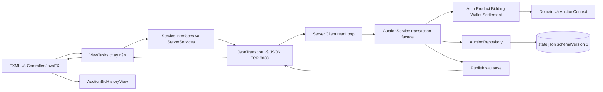

# Báo cáo ổn định Client, Mock và dữ liệu

Ngày thực hiện: **13/11/2026, UTC+7**. Maven chốt lúc **14:49:27+07:00** trên Windows 11.
**BUILD SUCCESS: 223 test, 0 failure, 0 error, 0 skipped; Checkstyle 0 lỗi.**
JaCoCo toàn bộ production đạt **80.84% LINE**, vượt mức 60% trong PDF hướng dẫn.
Linux/Xvfb và GitHub-hosted CI: **NOT TESTED**. LAN hai máy Windows: **NOT TESTED**.

## 1. Phạm vi, checkpoint và đối chiếu PDF

Đã trích xuất trực tiếp đủ **10 trang** `docs/2026-BTL.pdf` và **7 trang**
`docs/Hướng dẫn BTL LTNC-2026.pdf` bằng pypdf từ wheel có sẵn. Bản trích mới nằm
trong checkpoint, không dùng lại số liệu kết luận của báo cáo cũ. Đã đọc README,
MULTI_CLIENT_SETUP, FINAL_SIMPLIFICATION_REPORT, VAN_DAP, bộ viva và báo cáo CI cũ;
đối chiếu archive như lịch sử, không đưa tệp archive về docs gốc.

| Yêu cầu | Trang vật lý PDF | Đối chiếu source và kiểm chứng hiện tại |
|---|---|---|
| Đăng ký/login, Bidder/Seller/Admin | Đề trang 4; hướng dẫn trang 1 | AuthController → ServerServices → AuthLogic; form đăng ký thật và phân quyền có test |
| CRUD, tên/mô tả/giá/lịch | Đề trang 4–5 | SellerProductsController/ProductLogic; CRUD, validation, ảnh và quyền sở hữu có test |
| Bid hợp lệ, leader, tự đóng/trạng thái | Đề trang 5 | BiddingLogic, server.model.Auction, SettlementLogic; test mốc giờ, hold/release và settlement một lần |
| GUI/MVC, Socket JSON, chỉ Server truy cập kho | Đề trang 6, 8–9 | FXML/controller → interfaces/adapter → TCP → service/domain → repository; Client không mở snapshot Server |
| Auto-bid, đồng thời, anti-sniping, push/chart | Đề trang 6–7, 10 | Giữ toàn bộ; PriorityQueue được dùng cả trong Server thật, không chỉ Mock |
| OOP, Singleton/Factory/Observer | Đề trang 8–9; hướng dẫn trang 1–3 | User/Item, ItemFactory, observer đăng ký/gỡ; MockDataStore là Singleton nghiêm ngặt, Server.getInstance là instance mặc định có constructor test |
| Maven/JUnit/CI/style | Đề trang 9–10; hướng dẫn trang 4–6 | Maven clean verify + JUnit/GUI/socket/JaCoCo/Checkstyle đã chạy; workflow Linux/Xvfb được giữ nguyên |
| Coverage >=60% | Hướng dẫn trang 4 | LINE 4.973/6.152 = 80,84%; không exclude production hay giảm assertion |
| File I/O, hiểu toàn bộ code và Git tiến độ | Đề trang 3; hướng dẫn trang 1, 4–7 | JSON atomic save/restart có test; tài liệu viva cập nhật. Không tự commit/push theo yêu cầu chủ dự án |

Lưu ý: Checkstyle hiện chỉ kiểm whitespace/newline cơ bản, **chưa phải kiểm toàn bộ
Google Java Style**. Chưa kết luận mọi tiêu chí chấm điểm sẽ được giảng viên chấp
nhận chỉ từ tên pattern. Server.getInstance không cấm tuyệt đối mọi instance.

Checkpoint riêng, được Git ignore:
`.maven-repository/client-stability-20261113/`.

- `source-before.zip`: nguồn tracked và untracked tại thời điểm bắt đầu; ZIP kiểm tra không lỗi.
- `baseline.json`: HEAD, Git status, SHA-256 nguồn, LOC và hash toàn bộ tệp trong data.
- `state-before.json`: bản sao snapshot thật, giữ riêng; không đính kèm nội dung vào báo cáo/Git.
- `baseline-source/`: giải nén nguồn nguyên bản để chạy baseline desktop độc lập.
- `test-tmp/`: thư mục tạm riêng cho @TempDir. Server test dùng cổng 0 và thư mục riêng.
- Log, bản sao Surefire/JaCoCo/Checkstyle, ảnh QA và manifest sau sửa cũng nằm tại đây.

HEAD trước/sau: `699ca8ff3998e10ea678596a5cfb93253347f232`. Có sẵn 7 tệp untracked trong docs/archive khi bắt đầu;
chúng được giữ nguyên byte. Không commit, push, merge, reset hay migrate dữ liệu.

## 2. Kiến trúc trước/sau

| Trước | Sau |
|---|---|
| AuctionRoomController tự cấu hình chart, sort history, tooltip và axes | AuctionBidHistoryView nhận một snapshot và lo toàn bộ phần trình bày history/chart |
| Controller còn giữ bid/auto-bid/countdown/observer/ViewTasks | Giữ các phần này cùng vòng đời phòng, không chia callback ra nhiều manager |
| ServiceRegistry tạo Mock ngay khi class được khởi tạo, default nội bộ là mock | Khởi tạo lazy; default server nhất quán Main/POM/launcher; Mock chỉ khi chọn rõ |
| Ví dùng chung khóa ViewTasks `wallet` cho đọc và ghi | `wallet-read` / `wallet-write`: event đến trước ACK không nuốt callback của lệnh nạp/rút |
| LOGIN có thể đăng ký feed bằng token cũ trước khi xác thực | LOGIN/REGISTER bỏ bước feed cũ; sau xác thực đăng ký lại bằng phiên mới |
| Auto-bid Server dùng danh sách sắp order | PriorityQueue lấy ứng viên theo đúng thứ tự ổn định cũ, dưới transaction/monitor hiện hữu |



Không đổi API client, framing/protocol hay schema JSON. Không thêm MySQL/.dat.
Phép tính tiền authoritative vẫn dùng long trong Server. Double của chart/DTO
chỉ phục vụ hiển thị. ServerServices dài 721 dòng nhưng đã có JsonTransport và
ServerMapper riêng; chỉ sửa lỗi auth có tái hiện, không chia thêm vì LOC.
SellerProductsController và HomeController giữ nguyên vì chưa có căn cứ sửa.

## 3. Quyết định từng Mock và ảnh hưởng kiểm thử

**Giữ nguyên cả sáu lớp, 1.370 LOC**. Không xóa, chuyển hoặc sao chép Mock sang test
khi bản chạy phát triển vẫn hỗ trợ `run.ps1 Client -Mock`. Bản demo chính thức dùng
Server, không có fallback từ lỗi mạng sang Mock.

| Lớp | Caller thật trong main | Test/fixture liên quan | Quyết định và lý do |
|---|---|---|---|
| MockDataStore (505 dòng) | ServiceRegistry và 5 lớp Mock còn lại | 6 file test tham chiếu; createForTesting cấp kho riêng | Giữ kho chung/Singleton, tránh trộn state ví/sản phẩm/observer |
| MockAuctionClientService (380) | ServiceRegistry; AuctionRoomController kiểm dev mode | 6 file test tham chiếu, gồm ClientUiTest và các subclass có gate | Giữ để điều khiển timeout, queue, bid callback và lifecycle deterministically |
| MockAutoBidService (92) | Registry; nhánh nhận biết rejection đã xác định của phòng | MockAutoBidServiceTest và GUI auto-bid validation | Giữ để không biến rejection cục bộ thành UNKNOWN |
| MockWalletService (85) | Registry; UI gọi qua WalletService | MockWalletServiceTest, MockAutoBidServiceTest và GUI ví qua registry | Giữ hold/release/settlement fixture đồng bộ với kho |
| MockManagementService (199) | Registry cấp Product/UserAdmin/AuctionAdmin contracts | 4 file test tham chiếu và GUI Seller/Admin | Giữ CRUD/phân quyền fixture và fixture danh sách/route |
| AutoBidEngine (109) | MockAuctionClientService.placeBid; MockAutoBidService | MockAutoBidServiceTest qua hai caller | Giữ engine hoạt động/PriorityQueue, không phải class chết |

`mock-callers.json` lưu đầy đủ file có tham chiếu symbol (không tính định nghĩa
chính nó). Số file lexical không bằng số hành vi: GUI còn dùng dịch vụ qua registry
và interfaces. Sáu suite chuyên Mock vẫn có **18 case**, ClientUiTest **16 → 18**,
không giảm test. Mock không phải bằng chứng nhiều Client Server thật.

Phương án bỏ khỏi production đã cân nhắc: chuyển 6 lớp sang test, sửa ít nhất
ServiceRegistry + AuctionRoomController, ba harness ClientUiTest/ServiceRegistryTest/
ServerUiIntegrationTest và run.ps1: **12 tệp hiện hữu**, cộng một factory fixture
mới để inject nguyên bộ. Main/POM có thể còn được giản lược thêm; sáu service
interfaces vẫn hữu ích cho MVC và test. Phải thay cả kiểm tra mixed mock/server,
mode, dev handler, phân loại auto-bid rejection và setup các test có gate. Chưa có
phương án thay thế chạy tương đương được chứng minh trước khi xóa; thực hiện ngay
sẽ tăng rủi ro trước bảo vệ. Vì vậy không xóa chỉ để giảm LOC.

Dù giữ Mock, đã sửa phần bất hợp lý có bằng chứng: registry không tạo kho giả lúc
chạy thật. Test absentModeUsesOnlyServerAdaptersAndFailureNeverEnablesMock kiểm
cả sáu contract cùng một ServerServices, lỗi socket vẫn giữ adapter và nhãn SERVER.

## 4. Tách Client và sửa lỗi cụ thể

Lớp mới duy nhất trong production: `client/ui/AuctionBidHistoryView` (215 dòng).
Nó cấu hình chart/placeholder, nhận Auction + List<Bid> + giờ Server, thay chart
và danh sách từ cùng snapshot, sort timestamp, giữ 30 điểm cuối và gắn tooltip.
Axes được tính một lần sau khi dựng snapshot thay vì sau mỗi điểm. Không I/O,
không service, không timer/listener mạng, không phụ thuộc Controller.

| Method/trách nhiệm trước | Sau |
|---|---|
| AuctionRoomController.setupChart | AuctionBidHistoryView.setupChart, constructor gọi |
| setupPlaceholder | Placeholder và clip danh sách vào constructor helper; clip container còn tại controller |
| loadBidHistory | AuctionBidHistoryView.render(Auction, List<Bid>, LocalDateTime) |
| formatBid | AuctionBidHistoryView.formatBid |
| addPricePoint | AuctionBidHistoryView.addPricePoint |
| attachPointTooltip | AuctionBidHistoryView.attachPointTooltip |
| updateChartAxes | AuctionBidHistoryView.updateChartAxes |
| Xóa chart/list khi đổi phòng | AuctionBidHistoryView.clear |
| WalletController.run wrapper cho mọi tác vụ | Bỏ wrapper; reload và submit nạp/rút dùng hai khóa ViewTasks riêng |

Các lỗi sửa:

1. **Đối soát nhầm phòng:** refreshAuction chụp `bidKey` thành `key` trước khi submit.
   Worker cũ không được dùng field đã đổi khi đối soát UNKNOWN. UI callback cũ vẫn
   bị chặn bằng ViewTasks scope như trước; không hủy/retry lệnh đã gửi.
2. **Countdown giữ màu đỏ sau gia hạn:** tính lại style thường/urgent mỗi tick;
   gia hạn qua mốc 5 phút bỏ được màu urgent. Không đổi cách lấy giờ Server.
3. **Form Ví đứng chờ dù tiền đã nạp:** WALLET_CHANGED có thể đến trước ACK. Read
   cùng khóa `wallet` làm mất callback close dialog của write. Tách khóa đọc/ghi;
   luồng GUI mới kiểm tra hai lần nạp, một lần rút và số dư cuối đúng.
4. **Đăng nhập lại ngay sau restart thất bại:** feed subscription bằng token cũ có
   thể trả UNAUTHENTICATED trước LOGIN. response không dùng feed cũ cho hai action
   xác thực; request nghiệp vụ vẫn kiểm quyền, pending command không bị xóa.
5. **PriorityQueue trong chế độ thật:** yêu cầu được ghi rõ ở đề trang 10 và hướng
   dẫn trang 5. processAutoBids tạo heap theo rank của danh sách order đã sort ổn
   định; IdentityHashMap giữ rank theo đúng object, không phụ thuộc hash của JSON
   đang đổi. Mỗi vòng lấy bằng remove, bỏ leader/rule không hợp lệ, kiểm max/budget
   như cũ. Giữ ưu tiên cả trường hợp snapshot cũ có hai order bằng nhau. Không chia
   lock, transaction hay save; mọi bài auto-bid/budget/rollback cũ tiếp tục PASS.

## 5. Lifecycle, thread safety và giới hạn refactor

FXML fields vẫn do FXMLLoader inject trong Controller, không đổi FXML handlers.
Chart/list chỉ được helper cập nhật từ initialize/beginAuction hoặc callback FX.
Socket/image tiếp tục chạy qua ViewTasks và pool ảnh riêng. Không đổi thiết kế
executor, giới hạn hàng đợi hoặc dispatch Platform.runLater đã có test.

Giữ nguyên manual bid, auto-bid UI, BidSubmissionTracker, lịch sử navigation,
loading/error states và UNKNOWN. refreshAuction chụp khóa; read stamp chặn snapshot
cũ trước ACK. Realtime notification tải snapshot authoritative, không cộng điểm
chart từ hai event cạnh tranh. refreshAgain gộp yêu cầu đọc trong khi đang tải.

beginAuction/detachAuction/dispose tiếp tục gỡ đúng listener, dừng Timeline và
đóng scope đọc ảnh/UI. Lệnh nghiệp vụ đã được nhận vẫn hoàn tất trong worker và
ghi tracker bằng ticket cũ; không tự bỏ lệnh chỉ vì rời view. Test cũ vẫn kiểm tra
đổi phòng/rời view nhiều lần, số listener, timer STOPPED, callback cũ và khóa UNKNOWN.

Không tách Timer/AutoBidPanel/BidFormHandler vì chúng phụ thuộc chung trạng thái
khóa, refresh và vòng đời phòng. Tách thêm lúc này sẽ làm đường đi callback khó
lần theo. UserMenu và các test focus/outside click/Escape/owner hide được giữ nguyên.

## 6. LOC và độ phức tạp

Quy ước: `read_text(encoding='utf-8-sig').splitlines()`, gồm comment/dòng trống,
đếm working tree thật trước/sau; không tính target, .maven-repository, checkpoint
hoặc tài liệu txt vào Java LOC. Số trước lấy baseline.json, không lấy archive.

| Phạm vi | Trước | Sau | Chênh lệch |
|---|---:|---:|---:|
| Production Java | 11.650 | 11.704 | +54 |
| Client Java | 9.003 | 9.048 | +45 |
| Test Java | 4.580 | 4.940 | +360 |
| Số file production | 88 | 89 | +1 |
| Số file Client | 59 | 60 | +1 |
| Số file test | 27 | 27 | 0 |
| AuctionRoomController | 1.031 | 851 | -180 (17,46%) |
| SellerProductsController | 713 | 713 | 0 |
| ServerServices | 720 | 721 | +1 |
| HomeController | 506 | 506 | 0 |
| Mock folder | 1.370 | 1.370 | 0 |

Controller + helper mới: **1.031 → 1.066 dòng**. Tổng LOC không giảm và không được
báo thành “giảm code toàn dự án”. Lợi ích là một trách nhiệm biểu diễn đã được
đóng gói; controller bớt phải hiểu chi tiết axis/tooltip/sort/cap. JaCoCo complexity
của riêng AuctionRoomController **235 → 213**; toàn bundle **2.448 → 2.454** vì
thêm kiểm tra an toàn và đường khởi tạo lazy. Không dùng độ phức tạp toàn dự án
để tuyên bố refactor này đã giảm mọi nhánh. Không có dependency vòng mới.

Tất cả Java được sửa/thêm:

| File | LOC trước | Sau | Chênh lệch |
|---|---:|---:|---:|
| `src/main/java/com/auction/client/Main.java` | 86 | 85 | -1 |
| `src/main/java/com/auction/client/controller/AuctionRoomController.java` | 1031 | 851 | -180 |
| `src/main/java/com/auction/client/controller/WalletController.java` | 388 | 385 | -3 |
| `src/main/java/com/auction/client/service/ServiceRegistry.java` | 189 | 202 | +13 |
| `src/main/java/com/auction/client/ui/AuctionBidHistoryView.java` | 0 | 215 | +215 |
| `src/main/java/com/auction/client/service/server/ServerServices.java` | 720 | 721 | +1 |
| `src/main/java/com/auction/server/service/BiddingLogic.java` | 177 | 186 | +9 |
| `src/test/java/com/auction/integration/FullStackTest.java` | 375 | 386 | +11 |
| `src/test/java/com/auction/integration/ServerUiIntegrationTest.java` | 236 | 433 | +197 |
| `src/test/java/com/auction/client/controller/ClientUiTest.java` | 1581 | 1678 | +97 |
| `src/test/java/com/auction/client/service/ServiceRegistryTest.java` | 39 | 94 | +55 |

Tài liệu sửa: README.md, MULTI_CLIENT_SETUP.md, docs/VAN_DAP.md và cả 7 tệp
trong docs/viva theo thay đổi kiến trúc/caller/method. Sửa link tới archive,
chỉ rõ Mock/JSON demo, lịch bảo vệ và sao lưu/khôi phục. Báo cáo mới duy nhất:
`docs/FINAL_CLIENT_STABILITY_REPORT.md`. POM, workflow và launcher giữ nguyên
nội dung; không disable CI, đổi runner, skip GUI hay tăng timeout cũ.

## 7. Bằng chứng dữ liệu tạo qua UI và restart

`ServerUiIntegrationTest.uiCreatedAccountsProductsBidsWalletAndImageSurviveNonDemoRestart`:

- Server `demo=false`, port ngẫu nhiên, storage trong @TempDir. Fixture khởi đầu
  chỉ có các collection schema 1 rỗng, **không tài khoản hay sản phẩm mẫu**. Đây là
  fixture JUnit để không phụ thuộc mật khẩu admin trong môi trường, không thay
  đổi bootstrap của chương trình thật.
- AuthController form tạo 1 Seller và 2 Bidder. Form Ví nạp/rút thật qua TCP;
  mỗi Bidder có 5.000.000 đồng giả lập cuối bước chuẩn bị.
- Seller form tạo 2 phiên: một bắt đầu ở phút kế tiếp phù hợp, một ở ngày hôm sau;
  kết thúc cách thời điểm bắt đầu một ngày để không đóng ngoài ý muốn khi test.
- Form chỉ nhận HH:mm, nên test chờ đúng mốc mở bằng thời gian thực, tối đa 75 giây
  cho mốc xa nhất khoảng 70 giây. Đây là chờ lịch nghiệp vụ có căn cứ, không nới
  các timeout cũ để che lỗi.
- Một JavaFX window dùng Bidder A đặt 600.000 và bật auto-bid trần 1.000.000,
  increment 10.000. Adapter TCP đối thủ B đặt 700.000; auto A trả 710.000.
  UI history có 3 bid, giá 710.000, ví A held 710.000, B được release toàn bộ hold.
- Ảnh PNG fixture được upload bằng adapter thật của chính sản phẩm tạo từ form.
  Phần này không giả nhận là đã tự động hóa native FileChooser trong JUnit.
- Dừng Server, mở lại **cùng directory/cổng** với demo=false. Constructor không
  reset/reseed snapshot (so byte). Session cũ lỗi như dự kiến, login UI lại được.
  So nguyên WalletSnapshot, danh sách bid ID/thứ tự, giá, rule auto, hai sản phẩm
  và byte ảnh. Mở lại phòng trên GUI, history vẫn đủ 3 bid.

Ảnh chứng cứ: `target/qa/non-demo-before-restart.png`,
`target/qa/non-demo-after-restart.png`; bản sao nằm tại `final-ui-screenshots/` trong
checkpoint. Có kiểm tra trực quan phòng rộng/hẹp qua ảnh QA từ ClientUiTest.
Đây là **một cửa sổ GUI + adapter đối thủ trên loopback**, không phải hai máy LAN
hay hai tiến trình GUI đã được kiểm chứng.

Bổ sung kiểm tra Windows native riêng bằng Computer Use và harness QA tách biệt:
đã mở form Seller/Windows Open, quan sát ảnh được chọn và sản phẩm xuất hiện có
thumbnail. Form có trường dữ liệu do harness chuẩn bị, thao tác chọn ảnh/lưu được
quan sát trên UI. Ảnh thực tế được chọn khác PNG fixture dự kiến, vì vậy phép so
với fixture ban đầu trong native-image-qa.log **FAIL**; không coi đó là PASS hay
lỗi mất dữ liệu. Đối chiếu lại **chính imageBase64 đã lưu trong snapshot QA** với
byte ảnh do adapter tải về sau restart: **PASS**, 340.209 byte, SHA-256
`c8e1de5ea9892340cb9b8f6adc36e0ed1b93ee02268f156399f5bb981af9758d`.
Log cuối: `native-image-restart-check.log`. Không đưa ảnh/snapshot QA này vào Git
hoặc nội dung báo cáo. Kiểm tra native này không được tính vào 223 JUnit case.

Dữ liệu do nhóm tự tạo qua Server thật vẫn là dữ liệu nghiệp vụ JSON. Mock chỉ ở
RAM; fixture JUnit chỉ trong thư mục tạm. Client logout/thoát không reset kho.
README/MULTI_CLIENT_SETUP hướng dẫn dừng Server, copy state.json, đối chiếu SHA-256,
sao lưu hiện trạng trước khôi phục và restart cùng directory. Phiên quá deadline
vẫn phải được scheduler đóng/thanh toán; backup không đóng băng thời gian.

## 8. Kết quả kiểm thử và các lượt phát hiện lỗi

Môi trường Maven: Oracle JDK **25.0.4.1**, Maven **3.10.0**, JavaFX **26.0.2**,
Windows 11 amd64. `java` trên PATH là 26.0.2.1, nhưng Maven dùng JAVA_HOME JDK 25.
Các lệnh source-file QA cũng dùng `$env:JAVA_HOME/bin/java.exe`.

| Lượt / log trong checkpoint | Kết quả |
|---|---|
| baseline-verify.log, trong sandbox | 218 case; 1 failure Robot, 78 error chủ yếu hạn chế thao tác TempDir; không coi là PASS |
| baseline-desktop-verify.log, nguồn nguyên bản trong baseline-source | 218/218 PASS; 0 F/E/S; Checkstyle 0 |
| targeted-tests.log, ClientUiTest + ServiceRegistryTest + AuctionServiceTest | 42/42 PASS sau sửa đầu tiên |
| non-demo-ui-tests.log | 1/2 PASS; fixture email .test bị validation của UI chặn; đã sửa fixture .com |
| non-demo-ui-retry.log và non-demo-ui-diagnostic.log | Form nạp tiền timeout; phát hiện callback đọc/ghi cùng khóa, giữ nguyên assertion |
| non-demo-ui-wallet-fix.log | Qua ví/bid/auto/restart; phát hiện đăng nhập lại của adapter đối thủ còn dùng feed token cũ |
| non-demo-ui-reconnect-fix.log | 2/2 PASS: luồng UI + test login sau restart |
| final-clean-verify.log | 223 case; 1 error lookup button trước CSS/layout trong helper test nạp/rút; đã bổ sung applyCss/layout |
| final-verified.log | **223/223 PASS; 0 failure/error/skipped; JaCoCo report; Checkstyle 0** |
| snapshot-compatibility.log | Bản sao snapshot cũ load/validate bằng code hiện tại, byte không đổi |
| native-image-restart-check.log | Ảnh thực tế chọn từ native GUI giữ nguyên byte sau restart QA |

Các test cũ không bị xóa hay giảm assertion. Thêm 5 method test: 2 GUI phòng,
1 registry, 1 UI Server không seed, 1 full-stack login sau restart. Chỉ thêm lựa
chọn mock tường minh ở setup ClientUiTest/ServiceRegistryTest vì default registry
đã chuyển Server. Không dùng dữ liệu thật trong bất kỳ bài test nào.

| Suite | Cases | Failure | Error | Skipped |
|---|---:|---:|---:|---:|
| `ClientUiTest` | 18 | 0 | 0 | 0 |
| `ImageTasksTest` | 5 | 0 | 0 | 0 |
| `ViewTasksTest` | 4 | 0 | 0 | 0 |
| `BidSubmissionTrackerTest` | 4 | 0 | 0 | 0 |
| `MockAuctionBidAccessTest` | 1 | 0 | 0 | 0 |
| `MockAuthIntegrationTest` | 2 | 0 | 0 | 0 |
| `MockAutoBidServiceTest` | 6 | 0 | 0 | 0 |
| `MockManagementServiceTest` | 3 | 0 | 0 | 0 |
| `MockSharedStoreTest` | 2 | 0 | 0 | 0 |
| `MockWalletServiceTest` | 4 | 0 | 0 | 0 |
| `ServiceRegistryTest` | 3 | 0 | 0 | 0 |
| `ProductImagesIoTest` | 2 | 0 | 0 | 0 |
| `ProductImagesTest` | 1 | 0 | 0 | 0 |
| `UiResourcesTest` | 1 | 0 | 0 | 0 |
| `AuctionTimeTest` | 3 | 0 | 0 | 0 |
| `FormatUtilTest` | 2 | 0 | 0 | 0 |
| `ValidatorsTest` | 44 | 0 | 0 | 0 |
| `FullStackTest` | 12 | 0 | 0 | 0 |
| `ServerUiIntegrationTest` | 2 | 0 | 0 | 0 |
| `AuctionJsonMapperTest` | 4 | 0 | 0 | 0 |
| `AuctionRepositoryTest` | 12 | 0 | 0 | 0 |
| `AuctionTest` | 16 | 0 | 0 | 0 |
| `ItemFactoryTest` | 16 | 0 | 0 | 0 |
| `ServerIntegrationTest` | 3 | 0 | 0 | 0 |
| `AntiSnipingPolicyTest` | 5 | 0 | 0 | 0 |
| `AuctionServiceTest` | 21 | 0 | 0 | 0 |
| `AuctionStateValidationTest` | 27 | 0 | 0 | 0 |

| Nhóm nghiệp vụ | Bằng chứng |
|---|---|
| Đồng thời và ví dùng qua nhiều phiên | AuctionServiceTest.equalConcurrentBidsChooseOneLeaderAndRejectTheOtherAtTheNewPrice / concurrentAuctionsCannotOverspendOneWallet; ServerIntegrationTest.simultaneousEqualBidsCommitOnceAndMalformedClientDoesNotStopServer |
| Auto-bid trần/order/ngân sách, PriorityQueue | autoBidRespectsLimitBudgetAndRegistrationOrder; earlierAutoBidCannotBlockAnAffordableRivalAfterItsBudgetChanges; MockAutoBidServiceTest; hai adapter và UI thật |
| Anti-sniping | AntiSnipingPolicyTest; antiSnipingExtendsAndDoesNotSettleAtOldDeadline; GUI kiểm style sau gia hạn |
| Hold/release, hủy, settlement một lần | walletHoldsOutbidReleaseAndWithdrawAreConsistent; settlementPaysSellerExactlyOnceAndSurvivesRestart; canceledAuctionReleasesHoldAndStopsAutoBid |
| JSON/restart/cold JVM/reconnect | AuctionRepositoryTest, AuctionStateValidationTest, FullStackTest và test UI không seed |
| CommandId/idempotency/lost ACK | idempotencyRejectsChangedPayloadAndPersistsFinalOutcome; lostBidAcknowledgementRetriesTheSameCommandNotAnotherBid; pendingCommandSurvivesClientRestartAndIsAppliedOnlyOnce |
| Save failure và rollback | failedBidDoesNotPublishOrPersistAndSameCommandCanBeRetried; failedSettlementSaveRestoresBothWalletsAndRetryPaysExactlyOnce; storageFailureRollsBackMoneyAndCommandResult |
| Lifecycle/UNKNOWN/chart | Toàn ClientUiTest cũ và oldRecoveryCannotReconcileAnotherRoomUnknownCommand; historySnapshotOrdersCapsAndReplacesPointsAndExtensionClearsUrgency |
| Menu/focus | Giữ accountPopupClosesOnFocusLossEscapeAndOwnerHide / accountPopupSupportsOutsideClickKeyboardAndNavigation / accountPopupClosesWhenItsHeaderIsRemoved |

## 9. JaCoCo, Checkstyle và CI

| Counter toàn production | Baseline desktop mới | Sau sửa, clean verify mới |
|---|---:|---:|
| LINE | 4,825/6,130 = 78.71% | 4,973/6,152 = 80.84% |
| BRANCH | 1,694/2,603 = 65.08% | 1,770/2,615 = 67.69% |
| INSTRUCTION | 23,948/29,329 = 81.65% | 24,694/29,414 = 83.95% |
| METHOD | 823/1,115 = 73.81% | 837/1,115 = 75.07% |
| CLASS | 109/113 = 96.46% | 110/114 = 96.49% |

Checkstyle baseline/sau: **0 / 0 lỗi**. Không thêm exclude hay đổi quy tắc để xanh.
Coverage counter tính từ XML bundle, không lấy trung bình phần trăm các package.
Raw: target/surefire-reports, target/site/jacoco, target/checkstyle-result.xml.
Bản sao cố định: final-surefire-reports, final-jacoco, final-checkstyle-result.xml
trong checkpoint. Các cảnh báo JavaFX unnamed module/native access, deprecated
API ở WalletController và tài nguyên trùng khi shade vẫn là giới hạn hiện hữu;
build chốt đã thành công.

Lệnh tái lập đã chạy với quyền desktop cho Robot và quyền quản lý TempDir:

```powershell
mvn -o -B clean verify '-Dmaven.repo.local=.maven-repository' `
  '-Dauction.ui.tests=true' `
  '-DargLine=-Djava.io.tmpdir=D:/Bai-Tap-Lon-gon/.maven-repository/client-stability-20261113/test-tmp'
```

Máy có Maven/cache/temp bình thường dùng `mvn -B clean verify '-Dauction.ui.tests=true'`.
Không coi `-DskipTests package` hoặc verify không bật GUI là kết quả desktop đầy đủ.

**Linux/Xvfb local: NOT TESTED.** WSL --list báo chưa cài WSL; không thấy Docker,
Podman hoặc Xvfb khả dụng. **GitHub-hosted CI: NOT TESTED trong lượt này.** Không
suy từ Windows sang GTK/Xvfb. Đã đọc docs/archive/CI_FIX_REPORT.md và test popup hiện
hành, giữ các chờ focus/pulse, Robot target, outside-click và trace chẩn đoán.

Nhóm kiểm chứng trên GitHub sau khi tự review/commit/push revision muốn nộp:

1. Mở workflow CI, job `Java, Socket and JavaFX tests`; xác nhận đúng SHA.
2. Runner ubuntu-latest, Temurin 25, cài xvfb/libgtk-3-0/libasound2t64 như ci.yml.
3. Chạy `xvfb-run -a mvn -B verify -Dauction.ui.tests=true` đúng cấu hình hiện tại.
4. Tải artifact test-and-quality-reports, cộng các TEST-*.xml: kỳ vọng 223 case,
   0 F/E/S; kiểm LINE >=60% và Checkstyle 0. Chỉ ghi PASS khi artifact xác nhận.
5. Nếu popup lỗi, đọc trace owner/popup focus, bounds, AUTO_HIDE và Robot trong
   XML; sửa theo nguyên nhân, không skip test/đổi runner/tăng timeout vô căn cứ.

Không tự push/merge và không đổi workflow để né Linux.

## 10. Bảo toàn dữ liệu thật

Thư mục production mặc định: `data/`, xác định từ Server.getInstance và run.ps1.
Khởi động với `-Dauction.data=...` thì thư mục đó mới là nơi Server lưu. Client
chỉ có pending/cache riêng; tất cả Server QA trong lượt này dùng @TempDir hoặc
thư mục QA trong checkpoint, không khởi động Server trên dữ liệu thật.

Đã hash **1.436 tệp trong toàn cây data/**, bao gồm snapshot, backup và checkpoint
có sẵn (superset dữ liệu nghiệp vụ). So sau: **0 thay đổi, 0 thêm, 0 mất**.
Manifest đầy đủ lưu riêng tại baseline.json và data-hash-after.json; báo cáo không
chứa nội dung snapshot/tài khoản/ảnh cá nhân.

| File nghiệp vụ | SHA-256 trước | SHA-256 sau |
|---|---|---|
| data/state.json | `6c00dfceb67a9f9b114412d3e4eb04147ad26e022186f382e234d53cc1e56c15` | `6c00dfceb67a9f9b114412d3e4eb04147ad26e022186f382e234d53cc1e56c15` |

SnapshotCompatibility chỉ mở **bản sao** state-before.json trong thư mục QA mới,
qua AuctionService constructor → AuctionRepository.load → AuctionStateValidator.
Không start scheduler hoặc execute lệnh trên bản sao này. Load/validate PASS,
byte không đổi và hash khớp bảng trên. Không reset/migrate/ghi đè bản thật.
Kiểm tra restart có scheduler chỉ chạy trên fixture do UI tạo, không dữ liệu thật.

## 11. Rủi ro chưa giải quyết và checklist hai máy

- Linux GTK/Xvfb và GitHub CI chưa xác minh; Windows PASS không thay thế hai mốc này.
- Chưa chạy hai máy Windows/LAN, mất Wi-Fi thật, firewall hoặc nhiều tiến trình GUI
  trên hai máy. Socket nhiều client loopback và một GUI + đối thủ adapter đã PASS.
- Native FileChooser đã quan sát trên Windows; không nằm trong test CI tự động.
  Test native có tương tác desktop, ảnh được chọn thực tế khác fixture dự kiến;
  chỉ phép đối chiếu payload đã lưu qua restart được chốt PASS.
- Checkstyle chưa enforce toàn bộ Google Java Style. Mock vẫn trong production
  cho phát triển/test; phải chọn Server trong buổi bảo vệ như launcher mặc định.
- Khóa service chung và snapshot toàn bộ phù hợp quy mô bài tập, chưa kiểm thử tải
  lớn/mất điện thật/TLS. File lock/atomic move/idempotency không phải cam kết mạng
  exactly-once hoặc multi-writer phân tán.
- Snapshot demo không giữ phiên mở vô hạn: Server xử lý deadline thật sau restart.
  Hãy đặt lịch bảo vệ qua UI, không sửa JSON để kéo dài.

Chưa đánh dấu PASS cho checklist dưới đây:

| Thử trên ít nhất hai máy Windows | Mong đợi |
|---|---|
| Máy Server bind 0.0.0.0:8888, Client dùng IPv4 LAN thực | Hai Client đăng nhập riêng, tải cùng phiên, không chép thư mục data sang Client |
| Đăng ký Seller + 2 Bidder, tạo phiên/ảnh qua UI | Tên/ảnh/lịch/giá đúng trên cả hai Client, tài khoản không bị reset |
| Hai bidder đặt cùng giá gần đồng thời | Một giá được nhận; người sau bị từ chối theo giá mới; history/leader/ví nhất quán |
| A manual bid, B quan sát; bật auto-bid, thử trần bằng nhau | Push cập nhật giá/history/chart, không tự vượt leader/trần, thứ tự đăng ký đúng |
| Bid trong 30 giây cuối | Deadline tăng 60 giây, countdown/nhãn cập nhật, chưa settle ở deadline cũ |
| Xem ví, bị vượt giá, hủy và kết thúc | Hold/release đúng; nạp/rút dialog đóng sau ACK; settlement đúng một lần |
| Vào/ra phòng nhiều lần; đóng một Client đột ngột | Không listener/timer/callback trùng; Client còn lại tiếp tục dùng được |
| Ngắt mạng, khởi động lại Server cùng thư mục | UI báo lỗi; login lại được, pending cùng commandId được đối soát; dữ liệu còn |
| Mở popup tài khoản rồi đổi focus/cửa sổ, Escape | Popup không nổi trên cửa sổ khác, focus và điều hướng đúng |
| Dừng Server, sao lưu/khôi phục bộ demo riêng | SHA-256 bản sao khớp; không đưa snapshot, mật khẩu hoặc ảnh người dùng lên Git |

## 12. Nội dung nhóm cần học để bảo vệ

Theo các method hiện tại trong docs/viva/CODE_MAP.md:

1. Đường đi handlePlaceBid → ViewTasks → ServerServices.write/JsonTransport →
   Server.Client.readLoop → AuctionService.execute → BiddingLogic/WalletLogic →
   AuctionRepository.save → publish → snapshot mới → AuctionBidHistoryView.render.
2. Vì sao Server kiểm quyền/giá/ví/thời gian dù Client đã validation/disable nút;
   vì sao monitor bao cả ví nhiều phiên, receipt và save.
3. Phân biệt requestId/commandId, rejection/UNKNOWN, ticket/read stamp; chụp key
   khi chạy nền và không hủy lệnh đã nhận khi view đóng.
4. Push có thể đến trước ACK: lý do hai khóa đọc/ghi của Ví; điều kiện đăng ký feed
   khi login lại; timer/observer phải dừng/gỡ khi dispose.
5. PriorityQueue.remove khác iterator; rank/order ổn định, maxBid/increment/budget,
   anti-sniping và settlement một lần nằm ở Server thật.
6. User/Item inheritance và caller đa hình, ItemFactory, Observer, giới hạn
   Singleton của Server so với MockDataStore; không nhận có Strategy/Command GoF.
7. JSON là lựa chọn File I/O, không tự có transaction: atomic save, rollback,
   schema 1, file lock và restart; dữ liệu demo qua UI là nghiệp vụ thật.
8. Vì sao giữ Mock và chỉ tách một helper; tổng LOC tăng 54 nhưng controller giảm
   một trách nhiệm, các test tăng và coverage được đo lại. Phân biệt Windows,
   Linux local, GitHub-hosted và LAN hai máy khi trình bày bằng chứng.
