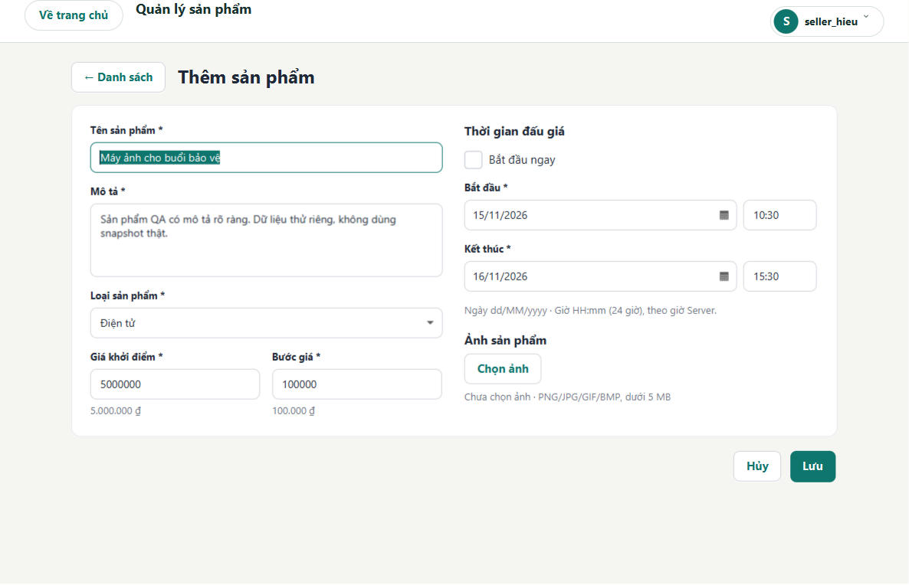

# Rà soát UI/UX JavaFX — 14/11/2026

Đã triển khai trên working tree hiện có, kiểm tra giao diện thật và chạy lại toàn bộ `clean verify` trên Windows. Kết quả cuối lúc **01:18:27 +07:00 ngày 14/11/2026: 233 test, 0 failure, 0 error, 0 skipped; BUILD SUCCESS**. Dữ liệu thật giữ nguyên. Không commit, push hoặc merge.

Phạm vi so sánh trong báo cáo là checkpoint ngay trước đợt UI/UX này, không phải Git HEAD. Working tree đã có thay đổi Seller/Mock từ đợt trước; các thay đổi đó được giữ lại. Các số liệu dưới đây được đo lại từ mã nguồn và kết quả test hiện tại.

## 1. Đối chiếu thiết kế Claude

Đã đọc toàn bộ `UI_THEM_SAN_PHAM.md`, hai PDF đề bài/hướng dẫn, README, báo cáo Seller/Mock, báo cáo stability/simplification và tài liệu viva liên quan. Yêu cầu trong nội dung người dùng dán là chỉ dẫn thực hiện; tài liệu Claude là đề xuất thiết kế cần thẩm định.

| Quyết định | Nội dung |
|---|---|
| Giữ | Card trắng căn giữa, giới hạn 1.000 px; padding 24; hai cột khi đủ rộng; nhãn rõ; hai trường giá cùng hàng; footer sát form; input 40 px, góc 8 px, card 12 px |
| Điều chỉnh | Chuyển thành một cột ở cửa sổ nhỏ; tính theo chiều rộng nội dung thực để tránh sai số border/pixel; chỉ cuộn nội dung khi cần; footer luôn nằm ngoài vùng cuộn |
| Điều chỉnh | CSS dùng scope `seller-form`/`form-controls`, áp dụng chọn lọc và kiểm tra các trang sử dụng; tách ba trách nhiệm UI thật, không giới hạn sửa ở FXML |
| Bỏ | MinWidth cửa sổ 900 px; đổi locale toàn JVM; sửa global `.root`/mọi TextField; kéo TextArea cho đầy card; bóng đổ/trang trí dư thừa |

Giữ Java 25, JavaFX, Maven, TCP/JSON và mô hình một Server nhiều Client; không thêm thư viện hoặc framework UI.

## 2. Các lỗi đã xác minh và sửa

- Form cũ dài, footer xa nội dung, giá/bước giá chiếm hai hàng; gom vào card vừa nội dung và dùng hai cột có chuyển về một cột.
- DatePicker có cả viền ngoài lẫn viền editor bên trong; bỏ riêng viền editor trong scope, giữ calendar arrow và focus border ngoài.
- Ô giờ thiếu chiều rộng; cố định 96 px và dùng placeholder ngắn `HH:mm`.
- Có nhiều cách nhập thời gian; bỏ lựa chọn thời lượng, giữ một cặp bắt đầu/kết thúc và checkbox “Bắt đầu ngay”.
- Form vừa mở đã có cảnh báo; dùng hướng dẫn trung tính ban đầu, một footer lỗi khi tương tác, giữ bản nháp khi lưu thất bại.
- Dialog thiếu quản lý owner/trang; chuẩn hóa owner, WINDOW_MODAL và đóng khi thay trang/ẩn owner.
- Sidebar Admin 260 px làm mất diện tích bảng ở 640 px; chuyển ba thao tác có sẵn thành hàng điều hướng tự xuống dòng, cho bảng cuộn ngang để tới cột thao tác.

Trong quá trình làm còn phát hiện và sửa: focus sớm qua `lookup` trước khi ScrollPane có Skin; hai cột bị xuống dòng vì chưa trừ border; ảnh cache Server đuôi `.img` bị coi là ảnh chọn mới; accessible text của ô giờ che giá trị nhập. Các trường hợp này đã có kiểm tra tương ứng.

## 3. Ảnh trước/sau

Ảnh “trước” được dựng lại bằng đúng Controller/FXML/CSS trong checkpoint, cùng dữ liệu fixture và cùng bộ dựng ảnh. Ảnh “sau” dùng mã mới. Tên kích thước là kích thước Stage; ảnh nội dung không gồm khung tiêu đề Windows.

| Stage | Trước | Sau |
|---|---|---|
| 1200×800 | [Ảnh trước](qa/ui-ux-review/before-1200.png) | [Ảnh sau](qa/ui-ux-review/after-1200.png) |
| 960×720 | [Ảnh trước](qa/ui-ux-review/before-960.png) | [Ảnh sau](qa/ui-ux-review/after-960.png) |
| 640×640 | [Ảnh trước](qa/ui-ux-review/before-640.png) | [Ảnh sau](qa/ui-ux-review/after-640.png) |



[Phần cuối form 640×640 ở scale 150%](qa/ui-ux-review/after-150-small-bottom.png) cho thấy ngày/giờ và Lưu/Hủy vẫn truy cập được. Đã xem trực tiếp ảnh rộng, vừa, hẹp và phần cuối cuộn để đánh giá độ cân đối, chữ và khoảng cách.

## 4. Quy chuẩn áp dụng

| Thành phần | Giá trị |
|---|---|
| Nền Seller / card | `#F5F5F2` / `#FFFFFF` |
| Chính / hover | `#0F766E` / `#115E59` theo bảng màu có sẵn |
| Chữ / phụ / viền input / lỗi Seller | `#1F2937` / `#6B7280` / `#D1D5DB` / `#DC2626` |
| Input / button trong nhóm form | Cao 40 px, radius 8 px |
| Card Seller | MaxWidth 1.000 px, radius 12 px, padding 24 px |
| Nhãn → field / nhóm / cột | 6 / 16 / 28 px |
| TextArea mô tả / ô giờ | Cao 96 px / rộng 96 px |
| Responsive | Hai cột từ chiều rộng view 820 px; dưới đó một cột, giá/bước giá xếp dọc |

Không thay CSS toàn cục của các control. Nút điều hướng và bảng giữ phong cách hiện có; trong từng nhóm thao tác mới, nút chính/phụ cùng chiều cao và góc. Nút mắt mật khẩu giữ kích thước icon riêng và chừa padding để không đè chữ. Disabled button trong scope có opacity 0,65; focus và trạng thái lỗi vẫn phân biệt được.

## 5. Ngày/giờ cuối cùng

Dùng DatePicker JavaFX chuẩn, editor `dd/MM/yyyy` và TextField `HH:mm` 24 giờ; parser ngày strict bằng `dd/MM/uuuu`, không nhận ngày không tồn tại. Không yêu cầu nhập giây. Calendar arrow và thao tác chọn ngày vẫn hoạt động.

“Bắt đầu ngay” disable hai ô bắt đầu, dùng đồng hồ Server qua `serverNow()`. Controller lấy lại giờ này sau khi xử lý ảnh, ngay trước gọi service lưu; không làm tròn lên phút kế tiếp. Bỏ checkbox khôi phục cả ngày/giờ và nội dung gõ tay trước đó, không đổi kết thúc. Server tiếp tục xác thực cuối cùng.

Kiểm tra thiếu/sai ngày giờ, ngày không tồn tại, bắt đầu đã qua, kết thúc không sau bắt đầu, thời lượng quá 365 ngày; kiểm tra lại lúc bấm Lưu để phát hiện form đã hết hạn. Tiền phải là số nguyên dương chính xác, tối đa 9.000 tỷ; không ép làm tròn số thập phân.

**Giới hạn locale:** định dạng editor là dd/MM/yyyy, nhưng tên tháng/thứ trong popup dùng locale FORMAT của JVM JavaFX. Môi trường thử hiện hiển thị tiếng Anh. Không gọi `Locale.setDefault`, không sửa Skin nội bộ hoặc viết lịch riêng để giả Việt hóa; chưa có Việt hóa tên tháng/thứ theo từng control.

## 6. Rà soát các màn hình

| Màn hình | Thay đổi / kiểm tra |
|---|---|
| Login/Register | Scope input/nút 40 px, góc 8 px; giữ nút mắt, vai trò và luồng đăng nhập/đăng ký; kiểm tra form cuộn ở 640 px — [ảnh](qa/ui-ux-review/auth-640.png) |
| Home | Áp dụng scope cho nhóm lọc; giữ tab lịch sử, tìm kiếm, loại/trạng thái, card và điều hướng; GUI test kiểm tra danh sách hẹp và dữ liệu dài |
| Seller Products | Card mới, hai/một cột, ảnh, thời gian, footer, busy/draft/cleanup; giữ bảng và quyền CRUD |
| Auction Room | Scope nhóm đặt giá và auto-bid; kiểm tra rộng/hẹp, history/chart/realtime và lifecycle; không đổi quy tắc bid/timer |
| Wallet | Scope thao tác/lọc; kiểm tra số tiền dài và cuộn ở 640 px; giữ hold/release và settlement |
| Admin | Bỏ sidebar cố định, nhóm lọc tự xuống dòng, bảng có thanh ngang; GUI test kéo tới cuối và xác nhận đủ ba nút thao tác — [ảnh](qa/ui-ux-review/admin-640.png) |
| UserMenu | Rà focus, click ngoài, bàn phím, điều hướng; giữ logic popup và assertion Robot; chuẩn hóa owner cho alert lỗi |
| Guide/Contact | Rà nội dung, cuộn, điều hướng; giữ nội dung, chuẩn hóa owner/lifecycle dialog |

## 7. Tách class theo trách nhiệm

| Class / API chính | Trách nhiệm |
|---|---|
| `SellerProductsController.form/saveProduct/closeForm` | Điều phối trang, quyền, danh sách và gọi ProductService bằng ViewTasks; đóng view khi rời form |
| `SellerProductFormView.Draft/refresh/setBusy/showSaveError/close` | Nạp FXML, binding/validation hiển thị, snapshot bản nháp bất biến, Enter/ESC và trạng thái submit |
| `AuctionScheduleInput.selection/validationMessage/parseDate` | Control lịch chuẩn, trạng thái checkbox, parser và phản hồi lịch phía Client; không gọi service lưu |
| `ProductImagePicker.select/loadPreview/close` | FileChooser có owner, preview/kiểm tra ảnh qua task ảnh riêng, bỏ ảnh và hủy callback khi đóng |
| `ViewNavigator.prepareDialog` | Owner, modality, listener trang/owner và tháo listener khi dialog đóng |
| `ProductImages.imageDirectory` | Cho phép đường dẫn ảnh QA riêng qua `auction.client.images`; đường dẫn mặc định người dùng giữ nguyên |

Ba helper Seller đều được production dùng, không có phụ thuộc vòng. View nhận callback/supplier; Controller giữ service. Form nằm trong cùng Scene của trang Seller, không có Stage form mới. Hủy/rời trang đóng image task, gỡ action/default/cancel handler và không gửi lưu. Đang gửi thì chặn double submit; lỗi mở lại trạng thái sửa và giữ toàn bộ draft.

## 8. Các Controller giữ cấu trúc hiện tại

AuctionRoom đã có `AuctionBidHistoryView`, scope task và state xử lý phòng đang liên kết chặt; tách thêm chỉ vì 824 dòng sẽ làm khó theo dõi bid/recovery. Home điều phối lọc/card trên cùng dữ liệu; Wallet tập trung số dư/giao dịch; Admin tập trung hai bảng và thao tác quản trị. Đợt này chỉ đổi điểm chuẩn bị dialog và scope giao diện tại các lớp này, không phân mảnh các hành vi đang có kiểm thử.

ServerServices không có phụ thuộc UI mới cần sửa. Nghiệp vụ, concurrency, transport, schema/protocol, registry và persistence không đổi so với checkpoint UI/UX.

## 9. LOC mã nguồn từng file thay đổi trong đợt này

Đếm dòng vật lý UTF-8, gồm dòng trống/comment; file mới có mốc trước bằng 0. Không dùng số lượng dòng làm tiêu chí tách class.

| File Java (trong `src/`) | Trước | Sau |
|---|---:|---:|
| main/java/com/auction/client/controller/AdminController.java | 436 | 436 |
| main/java/com/auction/client/controller/AuctionRoomController.java | 824 | 824 |
| main/java/com/auction/client/controller/ContactController.java | 107 | 107 |
| main/java/com/auction/client/controller/GuideController.java | 81 | 81 |
| main/java/com/auction/client/controller/HomeController.java | 547 | 547 |
| main/java/com/auction/client/controller/SellerProductsController.java | 802 | 411 |
| main/java/com/auction/client/controller/WalletController.java | 385 | 385 |
| main/java/com/auction/client/navigation/ViewNavigator.java | 252 | 282 |
| main/java/com/auction/client/ui/AppFooter.java | 78 | 78 |
| main/java/com/auction/client/ui/AppHeader.java | 140 | 140 |
| main/java/com/auction/client/ui/AuctionScheduleInput.java | 0 | 168 |
| main/java/com/auction/client/ui/ProductImagePicker.java | 0 | 121 |
| main/java/com/auction/client/ui/ProductImages.java | 127 | 128 |
| main/java/com/auction/client/ui/SellerProductFormView.java | 0 | 187 |
| main/java/com/auction/client/ui/UserMenu.java | 308 | 308 |
| test/java/com/auction/client/controller/ClientUiTest.java | 1.832 | 2.053 |
| test/java/com/auction/client/ui/ProductFormValuesTest.java | 0 | 27 |
| test/java/com/auction/integration/ServerUiIntegrationTest.java | 465 | 515 |

| Resource (trong `src/main/resources/com/auction/client/`) | Trước | Sau |
|---|---:|---:|
| css/app.css | 187 | 226 |
| views/admin-view.fxml | 79 | 74 |
| views/auction-room-view.fxml | 210 | 210 |
| views/auth-view.fxml | 101 | 101 |
| views/home-view.fxml | 81 | 81 |
| views/seller-product-form.fxml | 0 | 53 |
| views/seller-products-view.fxml | 54 | 54 |
| views/wallet-view.fxml | 24 | 24 |

Các file có cùng LOC vẫn có thay đổi nội dung (ví dụ chuyển sang `prepareDialog` hoặc thêm style class). README, MULTI_CLIENT_SETUP và bốn tài liệu viva Architecture/Code Map/OOP/Viva Questions được cập nhật theo API/hành vi mới; báo cáo cũ và archive giữ nguyên so với checkpoint.

## 10. Tổng Java production/test

| Nhóm | File trước → sau | Dòng trước → sau | Chênh lệch |
|---|---|---|---:|
| Production | 83 → 86 | 10.412 → 10.528 | +116 |
| Test | 35 → 36 | 6.570 → 6.868 | +298 |

SellerProductsController giảm 391 dòng nhờ tách trách nhiệm, nhưng tổng production tăng 116 dòng. Không tuyên bố toàn dự án giảm LOC. Fixture/mock vẫn chỉ ở test; kiểm tra JAR không có class ứng dụng trong package mock/fixture hoặc AutoBidEngine cũ.

## 11. Responsive và DPI

| Scale đầu ra JavaFX | 1200×800 | 960×720 | 640×640 |
|---|---|---|---|
| 100% | PASS, hai cột | PASS, hai cột | PASS, một cột/cuộn dọc |
| 125% | PASS, hai cột | PASS, hai cột | PASS, một cột/cuộn dọc |
| 150% | PASS, hai cột | PASS, hai cột | PASS, một cột/cuộn dọc |

Bộ dựng ảnh đổi kích thước khi cùng form đang mở, ép scale bằng `glass.win.uiScale`, xác nhận `Stage.getOutputScaleX()`, kích thước input/giờ, vị trí Lưu và không tràn ngang. Đã xem trực tiếp ảnh tại các scale, gồm phần cuối form hẹp. Đây là kiểm tra output scale JavaFX trên Windows, chưa phải kiểm tra thay đổi DPI toàn hệ điều hành hay kéo qua nhiều màn hình.

Thử tương tác native trên Server/directory QA riêng: mở lịch và chọn ngày, FileChooser chọn ảnh, Tab, Enter lưu, Alt+Tab không xuất hiện form rời, ESC quay lại danh sách. Ảnh thực được chọn trong FileChooser khác ảnh PNG dự kiến của checker ban đầu nên checker đó báo khác bytes; không tính lượt đó là PASS. Đã chạy lại kiểm tra restart với đúng ảnh đã chọn: metadata và 38.448 byte ảnh được bảo toàn qua hai lần mở Server. Ảnh cá nhân không đưa vào docs/QA công khai.

## 12. Baseline và test cuối

| Lần đo | Kết quả thực tế |
|---|---|
| Baseline trước sửa, 00:31:34 +07 | 227 test, 1 failure, 0 error, 0 skipped; `accountPopupSupportsOutsideClickKeyboardAndNavigation` thất bại ở native outside click |
| Cuối, 01:18:27 +07 | **233 test, 0 failure/error/skipped; BUILD SUCCESS**, 3 phút 06 giây |

Đã chạy `clean verify` với GUI thật trên Windows, không bỏ GUI, không xóa/disable test hoặc nới assertion Robot cũ. ClientUiTest hiện có 25 test. Bổ sung bốn tình huống GUI và hai test parser/tiền; mở rộng test Server UI hiện có, không tính thao tác thủ công thành JUnit.

Phạm vi gồm Seller CRUD/quyền, lịch Server và hết hạn khi Lưu, giữ draft khi lỗi, busy/double submit, DatePicker Skin/focus, ảnh hợp lệ/sai/remove/cancel, dialog owner/navigation, Admin hẹp; các suite Socket/full-stack/concurrency/idempotency/rollback/reconnect/realtime/anti-sniping/ví/settlement/restart tiếp tục chạy. Full-stack dùng Server thật và thư mục tạm; ảnh được chọn qua cùng đường kiểm tra của picker, mở sửa ảnh cache `.img`, lưu và kiểm tra bytes sau restart; kiểm tra phiên tương lai và “Bắt đầu ngay”.

Một lượt trung gian gặp lỗi cleanup TempDir do đổi `user.home` sau khi JavaFX khởi tạo khiến DLL font Windows bị giữ. Đã bỏ cách cô lập đó, dùng riêng `auction.client.images`; giữ cleanup TempDir bình thường. Các lỗi phát hiện trong phát triển và log baseline được giữ riêng, không đổi thành kết quả PASS.

## 13. Coverage và Checkstyle

Số liệu từ JaCoCo XML của lần `clean verify` cuối:

| Counter | Covered / tổng | Tỷ lệ |
|---|---|---:|
| Line | 4.612 / 5.583 | 82,61% |
| Branch | 1.722 / 2.401 | 71,72% |
| Instruction | 23.028 / 26.787 | 85,97% |
| Method | 813 / 1.052 | 77,28% |
| Class | 109 / 112 | 97,32% |

Checkstyle: **0 violations**, theo `config/checkstyle.xml` hiện có (quy tắc cơ bản về whitespace/newline); không đồng nghĩa toàn bộ Google Java Style. Không thay cấu hình chất lượng, dependency, POM hoặc CI để đạt kết quả.

## 14. SHA-256 và bảo toàn dữ liệu

Checkpoint gồm ZIP mã nguồn trước sửa, Git status/HEAD, LOC và manifest SHA-256 cho từng tệp dữ liệu. Đối chiếu cuối: **1.436/1.436 tệp trong `data/` trùng byte; không thêm/xóa/thay đổi tệp dữ liệu thật**.

`data/state.json` trước và sau cùng SHA-256:

```text
2b4190253c51918ec1a798f0209b1f724107c287a1f9e58b8536de070578f5f5
```

Hash nguồn xác nhận Server/shared/client service, POM, CI, launcher và archive giữ nguyên so với checkpoint đợt này. Không seed demo mặc định, không sửa JSON schema/protocol, không chỉnh tài khoản/tiền/lịch sử thật. Kiểm thử ghi vào thư mục tạm/QA riêng.

## 15. CI và LAN đã xác minh

| Môi trường | Trạng thái đợt này |
|---|---|
| Windows local, Maven + JavaFX GUI + Socket/Server thật cô lập | PASS theo lần verify trên |
| GitHub-hosted CI cho working tree này | **NOT TESTED** — không push/commit |
| Linux/Xvfb | **NOT TESTED** |
| LAN vật lý giữa nhiều máy | **NOT TESTED** |

Không lấy trạng thái CI hoặc LAN của báo cáo cũ làm bằng chứng cho working tree mới. Socket nhiều Client trên máy cục bộ được test nhưng không thay thế LAN vật lý.

## 16. Giới hạn còn lại và bằng chứng

- Popup calendar còn tên tháng/thứ theo locale JVM; định dạng nhập đã chuẩn hóa. Không đánh đổi tính ổn định JavaFX bằng sửa internal Skin/locale toàn cục.
- Robot click ngoài popup phụ thuộc foreground của desktop: baseline đã có một failure; các lần cuối chạy đủ assertion đã PASS. Kết quả này không bảo đảm Robot ổn định trong desktop bị ứng dụng khác giành focus.
- Các bảng nhiều cột tại 640 px dùng cuộn ngang; nội dung dài của Auction Room/Wallet/Register dùng cuộn dọc. Không thể hiển thị mọi nội dung cùng lúc trong cửa sổ nhỏ.
- Chưa kiểm tra Linux/Xvfb, CI hosted, LAN vật lý, chuyển DPI nhiều màn hình như mục 11/15.

Bằng chứng cục bộ không đưa vào Git nằm trong `.maven-repository/ui-ux-20261114/`: `source-before.zip`, `baseline.json`, `baseline-verify.log`, `final-clean-verify.log`, `final-audit.json`, `verified-surefire/`, `verified-jacoco/`, `verified-qa/`, `verified-checkstyle-result.xml`, log/ảnh render đủ chín tổ hợp và `native-qa-restart.log`. Snapshot dữ liệu/ảnh thật chỉ ở vùng riêng này. Bộ ảnh fixture dùng để xem/bàn giao nằm trong [qa/ui-ux-review](qa/ui-ux-review).

## 17. Nội dung bảo vệ/vấn đáp

1. MVC: Controller điều phối service/quyền; FormView quản lý bản nháp/trình bày; ScheduleInput và ImagePicker dùng composition từ control chuẩn. Client validation hỗ trợ người dùng, Server quyết định nghiệp vụ.
2. Concurrency: network và decode ảnh chạy qua scope ViewTasks; callback về FX thread; busy chặn gửi trùng; đóng/rời trang hủy task ảnh và ngăn callback cũ tác động view mới.
3. Thời gian: dùng giờ Server, lấy lại lúc lưu sau I/O; không lên phút tiếp theo; bỏ checkbox phục hồi bản nhập thủ công; kiểm tra lại hết hạn trước submit.
4. Lifecycle: form cùng Scene nên đi theo cửa sổ chính; dialog có owner và đóng khi owner/trang đổi; không tạo Stage form độc lập.
5. Responsive: card giới hạn chiều rộng, FlowPane tính từ vùng nội dung thực; chuyển cột và cuộn dọc, không tăng minWidth lên 900.
6. An toàn: mock/fixture chỉ ở test, không thay persistence/protocol; hash dữ liệu giữ nguyên; phân biệt kết quả Windows local với các môi trường chưa thử.

Tài liệu tra cứu mã đã cập nhật: [Architecture](viva/ARCHITECTURE.md), [Code Map](viva/CODE_MAP.md), [OOP](viva/OOP_EXPLANATION.md), [Viva Questions](viva/VIVA_QUESTIONS.md).
