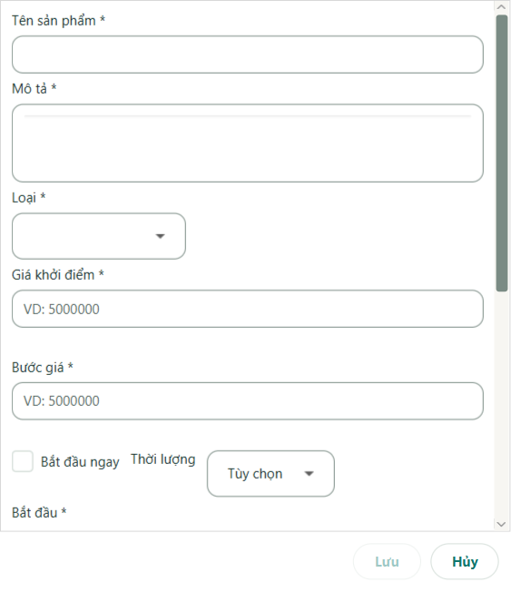
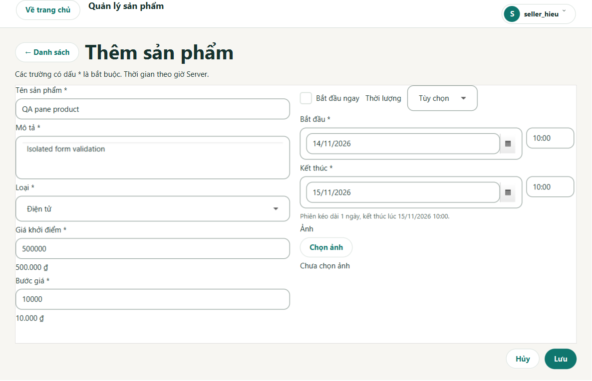
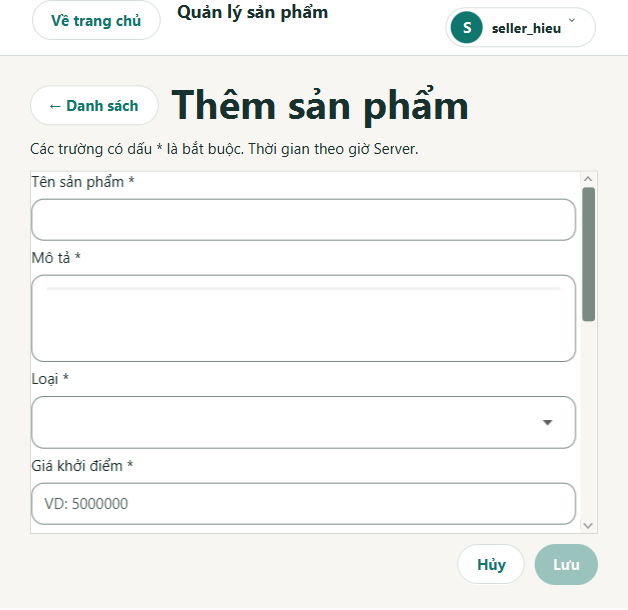
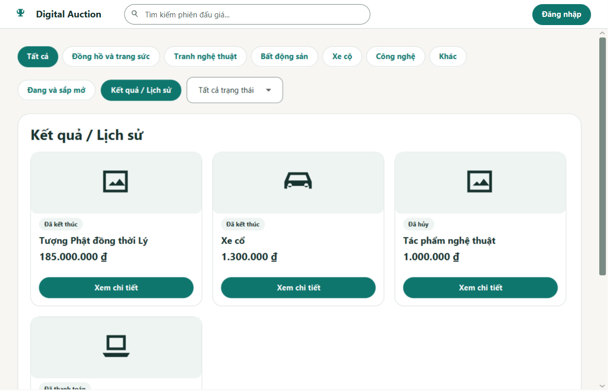
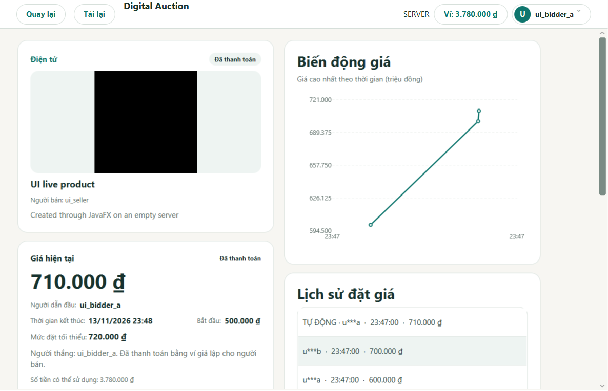

# Seller UI, Mock production và dữ liệu demo

Thực hiện ngày **13/11/2026, UTC+7**, trên Windows 11. Lượt đầy đủ chốt lúc
**23:48:30+07:00: Maven clean verify PASS, 227 test, 0 failure/error/skipped**.
Sau chỉnh màu tab được chọn, lượt verify tập trung lúc 23:51:19 tiếp tục PASS.
Không commit, push, merge hoặc xóa dữ liệu thật.

## 1. Checkpoint và phạm vi kiểm tra

Checkpoint trước sửa: `%TEMP%/auction-checkpoint-20261113-230734/`, gồm toàn bộ
src/docs/config/launcher/workflow và bản sao data, Git status cùng manifest SHA-256.
Bằng chứng mới lưu riêng tại `.maven-repository/seller-cleanup-20261113/` (Git ignore).
Không chạy Server thử trên data thật. Các test dùng @TempDir/cổng 0; native QA dùng
thư mục `native-qa/server`, cache và ảnh nhập riêng.

Đã trích và đọc hai PDF trực tiếp: đề 10 trang, hướng dẫn 7 trang; đối chiếu chức năng,
MVC/Socket, OOP/patterns, File I/O và coverage >=60%. README, MULTI_CLIENT_SETUP,
hai FINAL report, archive và viva là tài liệu đối chiếu; số liệu lịch sử không dùng
thay baseline. Bảy file archive untracked có sẵn được giữ nguyên byte.

Baseline ngoài sandbox: **223 test, 1 failure, 0 error/skipped**, lỗi
`accountPopupSupportsOutsideClickKeyboardAndNavigation` ở native outside click.
Chạy riêng bài popup cũng tái hiện lỗi. Lượt sandbox ban đầu gặp hạn chế desktop/temp
và không được tính là baseline PASS. Các lượt cuối giữ nguyên assertion Robot,
auto-hide, focus và keyboard, đều PASS; không sửa UserMenu để làm xanh test.
Native capture cho thấy có lúc cửa sổ JavaFX bị ứng dụng khác che dù toolkit báo focus;
đây là giới hạn môi trường desktop cần phân biệt với lỗi nghiệp vụ, chưa kết luận
mọi failure popup trước đó chỉ có một nguyên nhân.

## 2. Cửa sổ Thêm/Sửa: nguyên nhân và sửa chữa

Trước sửa, `SellerProductsController.form()` tạo `new Dialog<ButtonType>()`, không
`initOwner`, không gắn vòng đời vào trang Seller. Dialog có cửa sổ native riêng,
`showAndWait()` tạo nested event loop; dispose trang không đóng chính Dialog đó.
Source không có `setAlwaysOnTop`; không quy nguyên nhân cho một cờ không tồn tại.
Chưa tái hiện riêng đường thao tác khiến màn Ví nằm phía sau form như mô tả ban đầu.

Sau sửa, `seller-products-view.fxml` giữ `listPane` và `editorHost` trong cùng
StackPane/Scene. `form()` dùng lại cho Thêm/Sửa; `closeForm()` trở về danh sách,
đóng ViewTasks ảnh và tháo ESC. `dispose()` gọi cleanup khi điều hướng. Không có
Stage/Dialog dành cho form sản phẩm; Alt+Tab đi cùng cửa sổ chính.
FileChooser ảnh vẫn có owner là Window của editorHost.

Form rộng chia hai cột thông tin/lịch-ảnh; dưới ngưỡng viewport 760 chuyển một cột.
Nội dung cuộn; Lưu/Hủy ở ngoài vùng cuộn, luôn trong cửa sổ. Có tiêu đề và nút
← Danh sách. Lỗi lưu giữ bản nháp; thao tác đang gửi khóa form, tránh gửi lặp.
Giữ tên, mô tả, loại, giá, bước giá, ngày/giờ, thời lượng, ảnh và validation.
Ngày gõ không hợp lệ được kiểm từ editor, không âm thầm dùng ngày hợp lệ cũ.

Quyền và trạng thái vẫn do Server kiểm tra. UI còn chặn Sửa/Xóa phiên có bid,
không OPEN hoặc không thuộc Seller hiện tại. Không thay luật backend bằng nút disable.

Ảnh trước được dựng lại bằng **đúng controller/FXML của checkpoint**, fixture test
riêng; đây là ảnh DialogPane, không gồm thanh tiêu đề hệ điều hành:



Ảnh sau từ JavaFX test thật, dữ liệu hư cấu trong fixture:



Đã kiểm native Alt+Tab: chuyển ứng dụng khác không còn cửa sổ form nổi riêng.
ScaleSellerQa đo `Stage.getOutputScaleX()` đúng **1.0 / 1.25 / 1.5**, kiểm ba kích
thước **1200×800, 960×800, 640×640** ở mỗi scale; 9/9 PASS, không cắt nút Lưu
hoặc tràn ngang viewport. Đây là override scale JavaFX trên Windows, không thay
cài đặt DPI toàn hệ điều hành hay kiểm chuyển cửa sổ qua nhiều màn hình vật lý.



## 3. Sáu phiên đã kết thúc: nguồn gốc và quyết định dữ liệu

Phân tích **bản sao checkpoint**, không sửa snapshot gốc. Có 8 tài khoản, 6 phiên,
0 rule auto-bid, 21 receipt, 3 giao dịch ví. Cả sáu phiên có tên theo category,
mô tả `Sản phẩm demo để kiểm thử tích hợp`, giá khởi điểm/hiện tại 1.000.000,
bước 100.000, bắt đầu khoảng 13:47 ngày **06/11/2026**, kết thúc sau đúng hai giờ.
Các trường này khớp `AuctionService.seedDemo()`. Cùng sáu ID đã có trong backup
JSON-only ngày 11/11, nên không phải card mới sinh từ lần mở UI hiện tại.

| ID phiên | Danh mục |
|---|---|
| 78dccde0-8432-40a8-9610-beec82ee1984 | ELECTRONICS |
| e8de07bc-4866-4f01-af9c-2d1503266d05 | ART |
| 63bf3946-f86c-43ab-8430-eea0e965ce3f | VEHICLE |
| 9ed42667-0543-4b1c-a03e-13f51dac41e5 | JEWELRY |
| ef284c7c-93be-4c80-830e-8961f65574b4 | REAL_ESTATE |
| 74ad0ef9-1766-4c56-a6db-005ac8d73020 | OTHER |

Kết luận có căn cứ mạnh: **demo seed Server cũ đã được lưu thành dữ liệu JSON**,
không phải Mock RAM. JSON không có audit nguồn tạo nên không chứng minh được
tiến trình/người nào đã khởi tạo ngày 06/11, hoặc tuyệt đối loại trừ việc người dùng
tự nhập lại đúng nội dung seed. Các test hiện tại dùng thư mục tạm; không tìm thấy
caller test hiện hành ghi vào data/state.json mặc định. Không thể suy ngược rằng
mọi phiên bản test lịch sử đều chưa từng ghi nhầm.

Cả sáu có bids rỗng, không leader, settled=true, trạng thái FINISHED; không giao
dịch ví nào tham chiếu các ID trên. Ba giao dịch hiện có đều DEPOSIT. Vẫn **không
xóa**: marker settlement/lịch sử cần được giữ, chưa có xác nhận danh sách cụ thể và
quyền quản trị cho việc dọn. Không thêm bulk-delete hay bộ dọn JSON tự động.

## 4. Khởi động và hiển thị lịch sử

`Server.getInstance()` dùng demo=false cố định. Entry point chính không seed dù
còn JVM property cũ `auction.demo=true`; launcher vẫn truyền false. Test
ServerStartupTest kiểm tra không có mẫu, tạo tài khoản thật, restart giữ nguyên
snapshot và đăng nhập lại được.

**Giới hạn chủ động giữ:** constructor Java nhận demo=true và seedDemo vẫn còn
để các fixture integration/domain cũ tạo dữ liệu có kiểm soát. Cơ chế này không
được entry point/launcher chính gọi. Chưa tuyên bố xóa mọi đoạn seed khỏi production
source; xóa nó cần thay tiếp fixture Server, không cần cho đường chạy chính an toàn.

Home mặc định chỉ render RUNNING/OPEN. Tab **Kết quả / Lịch sử** chứa
FINISHED/PAID/CANCELED; chọn trạng thái tự chuyển đúng tab. Tìm tên/người bán,
danh mục và trạng thái cùng áp dụng. Terminal card chỉ có một badge trạng thái,
không thêm countdown ghi lại “Đã kết thúc”. Seller/Admin vẫn xem danh sách theo quyền.



## 5. Caller Mock trước sửa và nơi thay thế

| Class | Caller production cũ | Test được bảo toàn / nơi hiện tại |
|---|---|---|
| MockDataStore | ServiceRegistry.mockServices, constructor các Mock | fixture/MockDataStore; createForTesting, shared store và sáu suite service |
| MockAuctionClientService | Registry; AuctionRoom checkDevMode và nút mô phỏng | fixture cùng tên; auth/access/ClientUiTest, fake timeout/listener |
| MockWalletService | Registry, UI qua WalletService | fixture cùng tên; MockWalletServiceTest, SharedStore, GUI ví |
| MockAutoBidService | Registry; nhận diện class trong lỗi auto-bid của phòng | fixture cùng tên; AutoBid suite và GUI rejection/UNKNOWN |
| MockManagementService | Registry và kiểm tra không trộn bộ dịch vụ | fixture cùng tên; management/auth/shared store, GUI Seller/Admin |
| AutoBidEngine | MockAuctionClientService.placeBid, MockAutoBidService.registerAutoBid | fixture cùng tên; toàn bộ kiểm tra thứ tự trần/budget/concurrency/listener |

**Cả sáu class đã ra khỏi src/main và JAR ứng dụng.** Chuyển sang
`src/test/java/com/auction/client/fixture`; đối chiếu nội dung từng class chỉ khác
package, không bỏ logic hay assertion. FixtureServices.install() tiêm một store
cô lập qua setServices. Không có production import tới fixture.

Registry chỉ chấp nhận mode server, sáu thành phần TCP phải là cùng adapter/session;
không fallback. run.ps1 bỏ -Mock. Nút mô phỏng/nhãn dev và handler đã bỏ khỏi FXML/
AuctionRoomController. AutoBidException là hợp đồng từ chối cấu hình trước khi ghi;
transport/lỗi kết quả chưa rõ vẫn giữ UNKNOWN. Không chuyển luật bid/ví sang Client.

Không xóa JUnit test. Sáu suite Mock cũ còn nguyên hành vi/assertion với imports mới.
ClientUiTest đổi cách cài fixture và lookup Dialog → pane. Hai assertion chỉ dành
cho control/handler mô phỏng đã xóa được thay phạm vi kiểm tra pane/no-window và
lifecycle; các guard bid/auto-bid thực, UNKNOWN, timeout, late callback, listener,
hàng đợi và lỗi bất đồng bộ vẫn được chạy.

## 6. Thống kê Java và class/method

Đếm file .java dưới src/main/java và src/test/java, từ working tree checkpoint,
bao gồm dòng trắng/chú thích; không tính cache/target/reference .txt.

| Phạm vi | Trước | Sau |
|---|---:|---:|
| File Java production | 89 | 83 |
| Dòng vật lý production | 11.704 | 10.412 |
| Dòng không trắng production | 10.566 | 9.387 |
| File Java test | 27 | 35 |
| Dòng vật lý test | 4.940 | 6.570 |

Production giảm **1.292 dòng**; 1.370 dòng của sáu Mock được chuyển sang test,
không bị vứt bỏ. Không đổi interface MVC, JSON schema, giao thức hay repository.

- Thêm class test FixtureServices và ServerStartupTest; không thêm class production.
- SellerProductsController: thêm closeForm, listPane/editorHost/formImages; sửa form,
  date, run, dispose để giữ lifecycle và draft khi lỗi.
- HomeController: thêm trạng thái tab/bộ lọc, sửa applyFilters/buildAuctionCard.
- Registry: bỏ mockServices; sửa validateMode/modeLabel và kiểm tra cùng adapter.
- AuctionRoomController: bỏ checkDevMode/handleSimulateIncomingBid và phụ thuộc Mock.
- AuthController bỏ nội dung hướng dẫn chế độ Mock; Server.getInstance tắt seed.
- Ba FXML liên quan và CSS tab được chọn cập nhật; README, setup và viva cập nhật.

## 7. OOP và Patterns có caller thật

Giữ Entity → User → Bidder/Seller/Admin và Entity → Item → Electronics/Art/Vehicle.
AuthLogic.createUser gọi getRoleName qua User; ProductLogic.createAuction gọi
Factory Method create/getCategory qua Item. Server domain tiếp tục dùng long cho tiền.

ItemFactory.create là abstract/override Factory Method; forCategory là selector
Simple Factory. Observer vẫn đi theo commit → publish → transport → listener → FX,
dispose gỡ listener. BiddingLogic.processAutoBids vẫn dùng PriorityQueue với thứ tự
đăng ký ổn định; các bài equal-maximum, budget, concurrency, anti-sniping còn chạy.

Singleton: Server.getInstance quản lý instance mặc định có ích cho main nhưng
constructor public phục vụ test, **không phải GoF Singleton nghiêm ngặt**.
MockDataStore private-constructor nay chỉ ở nguồn test. Không lấy class test làm
bằng chứng production hay tạo Singleton giả; tài liệu vấn đáp nêu rõ giới hạn này.

## 8. Kiểm thử thực tế và chất lượng

| Lượt | Kết quả |
|---|---|
| Baseline đầy đủ ngoài sandbox | 223 tests; 1 failure popup; không coi PASS |
| Test chuyển fixture/form/registry ban đầu | Phát hiện lookup trước CSS/layout; đã sửa helper đợi layout |
| Test form, validation, lỗi lưu, cleanup và lịch sử mới | 3/3 PASS |
| Clean verify đầy đủ 23:44:30 | 227/227 PASS |
| Clean verify bản test cuối 23:48:30 | **227/227 PASS**, 0 failure/error/skipped |
| Verify tập trung sau CSS tab 23:51:19 | 1/1 GUI PASS, đóng gói và Checkstyle PASS |
| ScaleSellerQa | 9/9 tổ hợp scale/kích thước PASS; đã xem ảnh |
| Native chọn ảnh/lưu/mở lại Server QA | Sản phẩm và ảnh đã chọn giữ nguyên byte qua restart |

Lượt native đầu so với ảnh PNG dự kiến báo mismatch vì UI đã chọn JPEG khác;
không tính lần đó PASS. Lượt readback/restart sau đối chiếu chính ảnh đã chọn,
38.448 byte, PASS; không đưa ảnh được chọn hoặc snapshot QA vào Git.

Ba GUI test bổ sung kiểm form cùng Window, Lưu/Hủy/Back/ESC, ngày gõ sai, giới hạn
trường, lỗi lưu giữ draft, cleanup ảnh khi điều hướng, trạng thái/tab/tìm kiếm/danh mục,
không có countdown lặp trên terminal card. ServerStartupTest kiểm entry point/restart.
Các test socket/full-stack/concurrency/rollback/persistence có sẵn được giữ.

JaCoCo của **lượt clean đầy đủ**, không cộng lượt CSS sau: LINE **4.458/5.544 = 80,41%**;
BRANCH **1.625/2.367 = 68,65%**; INSTRUCTION **83,81%**. Không thêm exclusion để tăng
coverage. Mẫu số production giảm vì Mock đã chuyển đúng sang test.
Checkstyle **0 lỗi** cả verify đầy đủ và tập trung; rule hiện chỉ whitespace/newline
cơ bản, chưa phải toàn bộ Google Java Style. Các cảnh báo unnamed JavaFX module,
deprecated API và trùng tài nguyên Shade vẫn còn, không làm build thất bại.

Lệnh full đã chạy:

```powershell
mvn -o -B '-Dmaven.repo.local=D:\Bai-Tap-Lon-gon\.maven-repository' clean verify `
  '-Dauction.ui.tests=true' `
  '-DargLine=-Djava.io.tmpdir=D:/Bai-Tap-Lon-gon/.maven-repository/seller-cleanup-20261113/test-tmp'
```

Máy có Maven/cache bình thường dùng `mvn -B clean verify '-Dauction.ui.tests=true'`
trên desktop. Robot cần desktop/focus thật; không suy PASS từ build bỏ GUI.

## 9. Bằng chứng dữ liệu thật qua UI và restart

ServerUiIntegrationTest chạy demo=false trên @TempDir: đăng ký một Seller/hai Bidder
qua JavaFX; nạp/rút qua form; tạo ba sản phẩm qua pane mới (phiên ngắn, phiên tương
lai, phiên còn chạy); bid tay và auto-bid qua phòng thật. Ảnh trong bài tự động tải
qua adapter thật; native FileChooser được kiểm riêng như trên.

Phiên ngắn đạt giá 710.000, scheduler chuyển PAID. Buyer balance còn 4.290.000;
Seller nhận 710.000. Phiên còn chạy giữ riêng 510.000 và rule active. Dừng Server,
restart cùng storage, login lại: snapshot ví, các ID bid, giá, ảnh, ba sản phẩm,
trạng thái PAID và rule active của phiên còn chạy đều giữ đúng; Seller không nhận
tiền lần hai. Byte snapshot ngay khi load không bị reseed/reset.



Ảnh/thông tin trong ảnh minh chứng là fixture hư cấu, không phải dữ liệu người dùng.

## 10. Dữ liệu thật trước/sau và CI

Toàn bộ **1.436/1.436 file trong data khớp SHA-256**, không thêm/xóa/thay byte.
SHA-256 state.json trước và sau:

```text
2b4190253c51918ec1a798f0209b1f724107c287a1f9e58b8536de070578f5f5
```

Manifest đầy đủ ở `data-integrity.json`, không đính kèm snapshot/tài khoản/token/
mật khẩu vào báo cáo. AuctionRepository/AuctionService và các business helper
không bị thay đổi trong lượt này; chỉ cấu hình seed ở entry point Server thay đổi.

Đã truy vấn GitHub connector: commit remote hiện tại
`f832295318c7bc465c6aaa878bb61579e6145535` có [CI run 157 SUCCESS](https://github.com/hgiang757/Bai-Tap-Lon/actions/runs/43393000651).
Đây là commit cũ, **không chứng minh bản sửa chưa commit/push này đã chạy CI**.
Workflow GitHub Actions giữ nguyên byte, không disable job/test.
**Linux/Xvfb cho bản sửa này: NOT TESTED. LAN vật lý nhiều máy: NOT TESTED.**

## 11. Artifact kiểm chứng và việc còn lại

Trong `.maven-repository/seller-cleanup-20261113/`: baseline.log,
baseline-surefire, final-clean-verify.log, final-surefire, final-jacoco,
final-checkstyle-result.xml, final-audit.json, data-integrity.json, ảnh 9 scale/size,
log native QA/readback, source helper QA. JAR cuối được kiểm không chứa class
`com/auction/.../mock`, fixture, Mock* hoặc AutoBidEngine. Annotation DoNotMock
của dependency Google không phải implementation Mock của ứng dụng.

Không tự dọn sáu phiên cũ. Nếu nhóm muốn xóa, cần quản trị hợp lệ, kiểm tra lại
nghĩa vụ/lịch sử trên dữ liệu mới nhất, backup/đối chiếu và xác nhận danh sách ID.
Không cần xóa chúng để demo: dùng tab đang/sắp mở và tự tạo dữ liệu qua UI thật.
Còn cần chạy CI cho revision sau khi nhóm tự review/push, diễn tập LAN hai máy và
thảo luận tiêu chí Singleton nghiêm ngặt với giảng viên. TCP hiện chưa TLS, JSON
snapshot/monitor chung phù hợp quy mô bài tập; không tuyên bố đã kiểm tải lớn,
mất điện, mọi filesystem hoặc mọi cấu hình nhiều màn hình.
