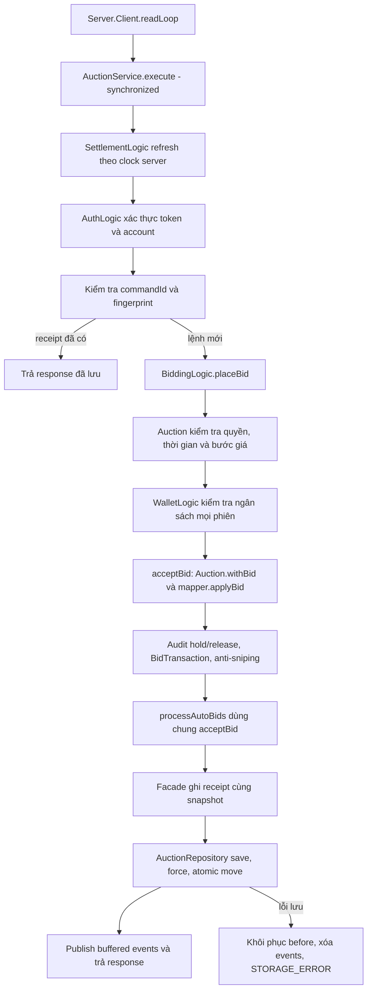

# Báo cáo refactor OOP và phân chia service

Ngày thực hiện: **12/11/2026, UTC+7**. Phạm vi: working tree `D:/Bai-Tap-Lon-gon`,
HEAD trước sửa `c84c4a65a4c1091b61126712fbfac13b33842b95`. Git sạch trước khi sửa;
không commit/push. Đây là số liệu đo lại, không kế thừa kết quả trong báo cáo cũ.

**Kết quả:** AuctionService **1.045 → 371 dòng**, 5 helper nghiệp vụ và một context
nội bộ; production **12.273 → 12.475 dòng (+202; +1,65%)**. **216/216 test PASS**,
0 failure/error/skipped; JaCoCo line **76,19%**; Checkstyle **0 vi phạm**.
Giữ JSON/schemaVersion=1, TCP protocol và hash tất cả file dữ liệu có trước.

## 1. Kiểm tra ban đầu và checkpoint

- Đọc đủ hai PDF gốc: `2026-BTL.pdf` (10 trang PDF) và
  `Hướng dẫn BTL LTNC-2026.pdf` (7 trang PDF), trích xuất theo từng trang bằng pypdf.
  Không dùng nội dung báo cáo cũ thay đề gốc.
- Đọc toàn bộ AuctionService, domain server, mapper/repository/validator và các
  test nghiệp vụ/network/GUI liên quan trước refactor. Không có AGENTS.md trong workspace.
- Checkpoint nằm trong thư mục ignored
  `data/oop-refactor-checkpoint-20261112/`: `source-before.zip` chứa file tracked
  trước sửa; `baseline.json` chứa HEAD/status/LOC/hash; `state-before.json` là bản
  sao dữ liệu thật. Chưa có thay đổi chưa commit cần hòa trộn ở thời điểm bắt đầu.
- Checkpoint còn chứa text PDF, log build, báo cáo baseline, metrics sau sửa,
  mã kiểm tra compatibility và dữ liệu kiểm thử riêng. Không đưa thư mục này lên Git;
  bản sao state có thông tin tài khoản của dự án.
- Có thể khôi phục các file đã sửa từ ZIP; sáu helper mới không nằm trong ZIP.
  Trước khi khôi phục cần giữ lại diff hiện tại và kiểm tra đúng danh sách file,
  không dùng reset toàn workspace. Không có hành động khôi phục tự động trong lần này.
- Không chạy Server, AuctionService hoặc scheduler trên `data/state.json` thật.
  Test dùng `@TempDir`; compatibility chỉ load/validate/map bản sao trong checkpoint.

## 2. Xác minh từng nhận xét của nhóm/Gemini

| Nhận xét | Kết luận từ source trước sửa | Xử lý |
|---|---|---|
| AuctionService hơn 1.000 dòng, nhiều trách nhiệm | **Đúng:** 1.045 dòng; cùng chứa auth, CRUD/ảnh, ví, bid/auto, thời gian, settlement, admin và commit | Tách 5 helper theo nghiệp vụ, giữ transaction facade |
| Cây OOP không tham gia nghiệp vụ | **Đúng một phần:** User/subclass được dùng lúc tạo tài khoản; Item/subclass dùng lúc tạo sản phẩm. Auction và BidTransaction đã chạy thật. AuctionStatus chỉ được AuctionDraft cũ sử dụng | Mở rộng Auction, đưa enum AuctionStatus vào production; không ép Item/User tham gia mọi bid |
| Business thao tác JsonObject quá nhiều | **Đúng:** giá/leader/hold/edit/cancel/lifecycle còn đọc và sửa trực tiếp cây JSON | Chuyển các luật phù hợp vào Auction; mapper merge trường bid; vẫn giữ aggregate JSON cho giao dịch |
| Thành viên khó giải thích | **Chưa đủ bằng chứng về khả năng từng người:** chưa phỏng vấn nhóm. Source dài và tài liệu trỏ sai method là vấn đề quan sát được | Sinh lại CODE_MAP, sửa hướng dẫn OOP/pattern/MVC và ví dụ không còn đúng |
| JSON vi phạm vì bắt buộc ObjectInputStream/ObjectOutputStream | **Không có căn cứ để kết luận:** PDF yêu cầu Serialization/lưu trữ nhưng không chỉ định hai API này | Giữ JSON; phân biệt rõ các khái niệm ở mục 3 |
| Có thể học cách chia service của repository tham khảo | **Đúng:** repository truy cập được; có các service theo nhóm nghiệp vụ đã nêu | Học ranh giới trách nhiệm; không sao chép code, object streams, khóa từng auction hay cơ chế lưu nền |
| 195 test, coverage 77,77% vẫn là số hiện tại | **Sai nếu dùng như kết quả hiện tại:** baseline desktop lần này là 203 test, line 75,61% | Đo lại cả trước/sau; không sửa báo cáo lịch sử để giả thành kết quả mới |

## 3. Đề gốc yêu cầu gì về OOP, I/O và Serialization?

Các trang dưới đây là **trang vật lý trong PDF**, tính từ 1. Đề chính có hai trang
mục lục nên số trang in trên giấy nhỏ hơn số trang PDF hai đơn vị.

| Tài liệu / trang | Nội dung yêu cầu và đối chiếu |
|---|---|
| [2026-BTL.pdf](2026-BTL.pdf), PDF **8**, trang in **6**, mục 3.3.1 | “Entity (Abstract Class/Interface): lớp cơ sở”; “Item (Abstract, kế thừa Entity)”; Electronics/Art/Vehicle; “User (Abstract, kế thừa Entity)”; Bidder/Seller/Admin; Auction và BidTransaction. Đề gọi đây là **gợi ý cấu trúc lớp** |
| Đề chính, PDF **8**, trang in **6**, mục 3.3.2 | “Encapsulation: private/protected + getter/setter”; “Inheritance: phân cấp rõ ràng”; “Polymorphism: override phương thức”; “Abstraction: abstract class / interface cho hành vi chung” |
| Đề chính, PDF **8**, trang in **6**, mục 3.4 | “Giao tiếp: REST API hoặc Socket (dữ liệu JSON)” |
| Đề chính, PDF **9**, trang in **7**, mục 3.4 | Client MVC (JavaFX + .fxml); server Controller → Model → DAO/Database; chỉ server truy cập database |
| Đề chính, PDF **9**, trang in **7**, mục 3.6 | “Singleton: quản lý kết nối / auction manager”; “Factory Method: tạo các loại Item (Electronics, Art, ...)”; “Observer: realtime update giá / bid”; “Strategy/Command (tuỳ chọn)” |
| Đề chính, PDF **7**, trang in **5**, mục 3.2.2 | Nhiều bidder đồng thời, không lost update, giá bị rollback hoặc hai người cùng thắng. Đây không cấm rollback một giao dịch chưa commit khi save thất bại |
| Đề chính, PDF **10**, trang in **8** | Bảng điểm liệt kê OOP, pattern, concurrency, realtime, MVC, Maven và JUnit; không có mục bắt buộc API Object Streams |
| [Hướng dẫn BTL LTNC-2026.pdf](<Hướng dẫn BTL LTNC-2026.pdf>), PDF **2** | “Lưu trữ dữ liệu (Serialization, File I/O)” là nội dung tự học. Tuần 6 yêu cầu cây User/Item và triển khai Singleton/Factory Method |
| Hướng dẫn, PDF **3** | Tuần 7: Observer, vòng đời phiên và synchronized/ReentrantLock; tuần 8: custom exception, JUnit, refactor SOLID và MVC |
| Hướng dẫn, PDF **4**, tuần 9, công việc 5 | **“[TỰ HỌC] Triển khai Serialization để lưu/tải dữ liệu.”** Có link học Serialization trong Java và video gửi Serialized Objects. Đây là hướng tài liệu học đáng lưu ý, nhưng không phải câu bắt buộc ObjectInputStream/ObjectOutputStream |
| Hướng dẫn, PDF **4** | Tuần 9 yêu cầu Maven/Checkstyle/CI; tuần 10 yêu cầu code coverage **≥60%** |
| Hướng dẫn, PDF **5**, tuần 11–12, công việc 4 | **“Hoàn thiện Serialization / lưu trữ dữ liệu.”** |
| Hướng dẫn, PDF **7** | JavaFX, lập trình mạng và lưu trữ dữ liệu (Serialization) là yêu cầu bắt buộc dù tự học |

Đã tìm trong đủ 17 trang: không có câu chỉ định bắt buộc
`ObjectInputStream`, `ObjectOutputStream` hay cặp `InputStream/OutputStream`.
Kết luận: **phải có lưu/tải dữ liệu bằng Serialization; chưa có quy định bắt buộc
Java Object Serialization**. Socket JSON được đề chính nêu rõ; điều này không tự
quy định định dạng lưu file, nên còn đối chiếu riêng yêu cầu lưu trữ trong hướng dẫn.

| Khái niệm | Ý nghĩa | Hiện trạng dự án |
|---|---|---|
| Java File I/O | Đọc/ghi file bằng API Java, độc lập định dạng nội dung | AuctionRepository dùng Files.readString, FileChannel.write/force và Files.move |
| JSON Serialization | Chuyển dữ liệu thành JSON và đọc ngược | Gson đọc/ghi cây snapshot; AuctionJsonMapper nối domain với JSON schema v1 |
| Java Object Serialization | Cơ chế nhị phân đồ thị object Java, thường dùng Serializable | Entity có marker Serializable; marker này **không chứng minh** production đã dùng object streams |
| Socket InputStream/OutputStream | Luồng byte của kết nối mạng | JsonProtocol dùng DataInputStream/DataOutputStream để đọc/ghi length + JSON UTF-8 |
| ObjectInputStream/ObjectOutputStream | Stream API cho object serialization nhị phân | Không dùng trong production hiện tại; không cần thêm chỉ vì file tham khảo có đuôi .dat |

Không đổi sang .dat, không chuyển dữ liệu thật, không thay giao thức. Nếu giảng viên
sau này xác nhận Java Object Serialization là tiêu chí riêng, phương án nhỏ có thể
xem xét là export/import **snapshot DTO có version** vào file riêng, với giới hạn
kích thước/ObjectInputFilter và kiểm tra dữ liệu trước nhập. Đây là **đề xuất chưa
triển khai**, không thay state.json và không deserialize object tùy ý từ Socket.

## 4. Đã tham khảo GitHub như thế nào?

Đọc trực tiếp qua GitHub connector ngày 12/11/2026, nhánh main của
[lydat0904/BaiTapLon](https://github.com/lydat0904/BaiTapLon).

| Source đã đọc | Trách nhiệm quan sát được / điểm học |
|---|---|
| [AuctionBiddingService](https://github.com/lydat0904/BaiTapLon/blob/main/src/main/java/com/auction/server/service/AuctionBiddingService.java), blob `a5a077d` | Kiểm tra và ghi bid, xử lý ký quỹ; có cộng tác với UserService và AutoBidService |
| [AutoBidService](https://github.com/lydat0904/BaiTapLon/blob/main/src/main/java/com/auction/server/service/AutoBidService.java), `ed0d0ec` | Registry, max/step và trigger tự động; dùng executor delay và gọi lại bidding |
| [AuctionSellerService](https://github.com/lydat0904/BaiTapLon/blob/main/src/main/java/com/auction/server/service/AuctionSellerService.java), `604689a` | Tạo/sửa/hủy phiên của seller và kiểm tra sở hữu |
| [UserService](https://github.com/lydat0904/BaiTapLon/blob/main/src/main/java/com/auction/server/service/UserService.java), `12f32c0` | Auth/account và giao dịch ví; cho thấy có thể nhóm việc quản lý user riêng |
| [ItemService](https://github.com/lydat0904/BaiTapLon/blob/main/src/main/java/com/auction/server/service/ItemService.java), `96a13aa` | CRUD/search Item qua DAO; ở dự án này sản phẩm nằm trong auction aggregate nên không tạo Item DAO/service riêng |
| [CheckoutService](https://github.com/lydat0904/BaiTapLon/blob/main/src/main/java/com/auction/server/service/CheckoutService.java), `da1ba73` | Thanh toán là nhóm nghiệp vụ riêng; dự án hiện tại tự thanh toán khi hết giờ nên dùng SettlementLogic |
| [AuctionSchedulerService](https://github.com/lydat0904/BaiTapLon/blob/main/src/main/java/com/auction/server/service/AuctionSchedulerService.java), `589cf24` | Tìm phiên hết hạn, cập nhật trạng thái và thanh toán; ở đây scheduler vẫn chỉ gọi facade.tick |
| [AdminFacadeService](https://github.com/lydat0904/BaiTapLon/blob/main/src/main/java/com/auction/server/service/AdminFacadeService.java), `6e44988` | Gom thao tác admin; quy mô hiện tại chưa cần thêm facade admin thứ hai |
| [FileAuctionDAOImpl](https://github.com/lydat0904/BaiTapLon/blob/main/src/main/java/com/auction/server/dao/FileAuctionDAOImpl.java) | save cập nhật map rồi submit ghi file trên executor; lỗi I/O ghi log, caller không đợi durable commit. **Không áp dụng cách lưu này** |
| [Domain Auction](https://github.com/lydat0904/BaiTapLon/blob/main/src/main/java/com/auction/shared/model/Auction.java), `8aa2d1e` và các interface DAO | Luật bid/lifecycle nằm trong model và service tách khỏi lưu trữ; không mang quy tắc bid/tiền khác của repository vào dự án này |

Không tạo dependency vòng bidding ↔ auto-bid như cách setter/callback của repository.
Manual và automatic competition cùng BiddingLogic, dùng chung acceptBid; ranh giới
lock/snapshot/commit vẫn do một AuctionService sở hữu. Không sao chép mã nguồn.

## 5. Class trước/sau và vai trò production thực tế

| Class | Trước | Sau và caller production |
|---|---|---|
| Entity | Abstract Serializable, private id/name/time và getter/setter; **không phải private final** | Giữ nguyên, làm base cho User/Item; không chứa ví authoritative, Socket hay File I/O |
| User / Bidder / Seller / Admin | Được createUser tạo theo role; getRoleName gọi qua tham chiếu User | AuthLogic.createUser vẫn dùng dynamic dispatch này; Seller còn là owner của Item trong ProductLogic.createAuction |
| Item / Electronics / Art / Vehicle | Factory tạo sản phẩm, service gọi getCategory qua Item | ProductLogic.createAuction dùng cùng luồng thật; rating/warranty/mileage không được dùng trong quyết định bid, không tuyên bố ngược lại |
| ItemFactory | Abstract create được override bởi anonymous creator; selector static có switch | Giữ nguyên: forCategory là Simple Factory, abstract/override create là Factory Method tham số hóa; không có sáu creator class riêng |
| Auction | Record bất biến, long currentPrice/minBidStep; String status; chỉ một số luật bid | Enum AuctionStatus, leader/totalBids/settled; thêm edit/cancel/auto/hold/lifecycle và withBid. BiddingLogic, WalletLogic, ProductLogic, SettlementLogic và Context.snapshot đều dùng thật qua mapper |
| BidTransaction | Đã được acceptBid tạo và mapper ghi vào bids | BiddingLogic.acceptBid tiếp tục dùng, cùng schema id/auctionId/bidderUsername/amount/timestamp/auto; không tự chuyển tiền |
| AuctionStatus | Chỉ được model AuctionDraft cũ tham chiếu | AuctionJsonMapper.auction chuyển JSON string sang enum; Auction và SettlementLogic dùng enum trong production |
| AuctionJsonMapper | Đọc bảy trường Auction, ghi BidTransaction | Đọc trạng thái có kiểu + leader/count/settled; applyBid merge bốn trường vào cây JSON gốc, không serialize lại toàn aggregate |
| AuctionService | Tất cả nghiệp vụ + transaction trong 1.045 dòng | Facade 371 dòng: startup, monitor, auth routing, receipt, snapshot rollback, durable save và publish |
| AuthLogic | Chưa có | Credentials, session 12 giờ, đăng ký và account admin; dùng WalletLogic khi kiểm tra nghĩa vụ trước đổi role/xóa |
| ProductLogic | Chưa có | Tạo/sửa/tìm sản phẩm, kiểm tra sở hữu/thời gian/ảnh, gọi factory; quyền editable do Auction quyết định |
| BiddingLogic | Chưa có | Manual + auto, kiểm tra ngân sách, chấp nhận bid, giữ/nhả tiền, chống sniping và thứ tự đăng ký auto |
| WalletLogic | Chưa có | Tính hold/available, nạp/rút và ghi audit ví; chỉ được gọi trong transaction facade |
| SettlementLogic | Chưa có | Chuyển trạng thái theo clock, thanh toán buyer/seller một lần, hủy admin và dừng rules |
| AuctionContext | Chưa có | Một aggregate JSON hiện tại, clock, utilities boundary, mapper/projection và buffer event; không save/publish/khóa riêng |
| AuctionRepository / AuctionStateValidator | Đã có | Giữ nguyên source: load/save đồng bộ, atomic replacement; validate dữ liệu khi startup |
| AuctionDraft / Bid / Transaction (server) | Không có caller production; có API tiền double cũ | Giữ để không mở rộng phạm vi dọn legacy; không trình bày chúng là model chạy bid thật |

User còn API ví `double`, Item còn basePrice `double`; các API này không được gọi
để tính tiền trong backend. Không chuyển ví đang dùng long qua chúng để làm đẹp
cây kế thừa. Auction/mapper/WalletLogic/SettlementLogic tiếp tục dùng **long**.
Các trường legacy này là hạn chế được ghi rõ, không phải bằng chứng hoàn thiện mọi model.

Domain có chính xác các caller sau:

- `requireBidder`: BiddingLogic.validateBidder, dùng cho bid và đăng ký auto.
- `requireMinimumBid`: placeBid và Auction.withBid; áp dụng cả bid đầu lẫn bid sau.
- `withBid`: acceptBid tạo giá trị mới có một leader, rồi mapper.applyBid cập nhật JSON.
- `isLeading`: auto-bid bỏ qua người đang dẫn, WalletLogic hoàn lại ngân sách phiên hiện tại.
- `heldBy`: WalletLogic.heldBalance cộng nghĩa vụ của cùng tài khoản ở mọi phiên chưa settled.
- `requireAutoBid`: setAuto; `requireEditable`: ProductLogic.editable;
  `requireCancelable`: SettlementLogic.cancel.
- `AuctionStatus.isActive`, `hasExpired`, `shouldStart`: SettlementLogic.refreshAuctions.
- `highestBidderId`, `currentPrice`, `settled`: settle chọn người mua và số tiền;
  không chọn winner thứ hai từ dữ liệu client.

Không gọi Auction hoặc BidTransaction là lớp có đa hình kế thừa. Chúng là record
bất biến. User/Item có đa hình override thực tế; các interface service client còn
cho phép controller gọi ServerServices hoặc mock theo mode được chọn rõ ràng.

## 6. Phân loại toàn bộ method AuctionService trước sửa

Tên trong cột phải là vị trí sau refactor; không chỉ là đề xuất.

| Nhóm | Method cũ → vị trí hiện tại |
|---|---|
| Authentication | validatePassword, authenticatedUser, login → AuthLogic; LOGOUT là auth.logout; authenticatedUserId vẫn là API synchronized của facade |
| User Management | publicUser, createUser, register → AuthLogic |
| Administration | manageUser → AuthLogic; cancel → SettlementLogic; LIST_USERS/ADMIN_LIST_AUCTIONS/DELETE_AUCTION vẫn được dispatcher kiểm tra quyền trước khi đọc/archival |
| Product/Auction Management | listAuctions, owner, editable, validateProduct, image, createAuction, updateAuction → ProductLogic; auction lookup và snapshot projection → AuctionContext |
| Manual Bidding | validateBidder, placeBid, acceptBid → BiddingLogic; quy tắc giá/quyền/time/leader vào Auction |
| Auto-Bidding | ruleKey, rule, setAuto, processAutoBids → BiddingLogic; không tách một AutoBidLogic chỉ để gọi vòng trở lại BiddingLogic |
| Wallet | wallet, heldBalance, availableForAuction, log, history, transfer → WalletLogic |
| Settlement | stopRules, settle, cancel → SettlementLogic |
| Scheduler/Time | refreshAuctions → SettlementLogic; now → AuctionContext; tick vẫn gọi execute trên monitor chung; Server scheduler không đổi |
| Persistence/Transaction | Hai constructor, execute, commit, handleAction, close ở facade; repository.save chỉ do constructor/commit gọi |
| Boundary/shared utilities | number, error, collection, values, id, required, money, requireRole, auction, snapshot, event → AuctionContext |
| Bootstrap/demo | seedDemo vẫn ở facade, gọi AuthLogic/ProductLogic/WalletLogic và xóa buffer event sau seed; chỉ dùng với demo=true trong dữ liệu thử |

Các helper là **package-private final**, được tạo đúng một lần trong constructor
facade và giữ cùng một context. Không thêm public entry point để thay ví ngoài
transaction. API external execute/authenticatedUserId/tick/close giữ nguyên.
Dependency nghiệp vụ đi về context/wallet/domain, không có callback service vòng.

## 7. Luồng đặt giá sau sửa



Receipt đã có vẫn đi qua commit để lưu các thay đổi refresh nếu có, rồi mới trả
response cũ; không tạo bid mới. Event có thể tới trước ACK vì publish sau save
nhưng trước khi readLoop enqueue response. Client vẫn phải đối soát commandId.

## 8. Giữ nguyên tính nguyên tử và concurrency

1. **Một monitor:** execute, authenticatedUserId, tick và close vẫn synchronized
   trên cùng AuctionService. Các helper không có synchronized/lock/executor riêng.
   Server giữ một facade cho mọi reader và scheduler của instance đó.
2. **Một snapshot:** context.state chứa users/auctions/rules/transactions/commands.
   Một tài khoản đấu nhiều phiên vẫn tính hold toàn cục trong cùng khóa; không có
   khoảng trống giữa kiểm tra ví và chấp nhận bid.
3. **Không cache domain mutable:** mapper dựng record từ trạng thái đang giữ khóa.
   withBid tạo record mới, mapper merge vào aggregate. Helper giữ context, không
   giữ một root JSON riêng; rollback thay context.state có hiệu lực cho mọi helper.
4. **Hai mốc rollback giữ nguyên:** lỗi action khôi phục afterRefresh và chỉ giữ
   event refresh; lỗi lưu/runtime khôi phục before. Không nhận thành công trước
   repository.save. Lỗi auto vượt 10.000 vòng vẫn ném AUTO_BID_LIMIT để rollback.
5. **Receipt cùng commit:** success/rejected response và fingerprint được lưu
   trong cùng snapshot với bid/ví/rules. commandId cũ không chạy lại action;
   payload khác bị CONFLICT; lỗi save không để lại receipt thành công.
6. **Settlement cùng ví:** hết giờ debit buyer, credit seller, log hai bên,
   settled/PAID và dừng rules trong một giao dịch. Không thêm luồng thanh toán riêng.
7. **Không phát event sớm:** AuctionContext.event chỉ tăng version/tạo buffer;
   commit mới gọi publisher. Lỗi lưu xóa buffer. Publisher lỗi sau commit vẫn
   không đảo ngược giao dịch đã bền vững; reconnect đọc snapshot để đối soát.
8. **Giữ persistence:** file lock, strict JSON/duplicate-key validation,
   FileChannel.force(true), ATOMIC_MOVE và từ chối fallback không nguyên tử giữ
   nguyên. Không dùng executor ghi file của repository tham khảo.

## 9. Compatibility và bảo toàn dữ liệu

- SchemaVersion=1, field names, integer money, LocalDateTime ISO theo
  Asia/Ho_Chi_Minh và frame TCP không đổi. AuctionStatus enum chỉ tồn tại nội bộ,
  JSON vẫn dùng OPEN/RUNNING/FINISHED/PAID/CANCELED như trước.
- applyBid chỉ merge highestBidderId/highestBidderUsername/currentPrice/totalBids;
  mapper.bid ghi nguyên schema bid cũ. Không biến record thành toàn bộ JSON state.
- Đăng ký lại auto-bid vẫn cấp id/order và cấu hình mới như trước, nhưng merge
  known fields vào rule cũ để giữ unknown fields. Đây là thay đổi có chủ đích về
  compatibility; không thay thuật toán giá hay ưu tiên đăng ký.
- Test mới thêm unknown field ở root, user, auction, bid và auto-rule; đăng ký lại
  auto, đấu thủ công + auto, settlement và restart rồi so sánh đầy đủ chúng.
- Kiểm tra compatibility ngoài JUnit: copy checkpoint state vào
  `compatibility/state.json`, chạy AuctionRepository.load + AuctionStateValidator
  và map từng auction. **PASS: schemaVersion=1, 6 auctions**. Không gọi save,
  AuctionService hoặc scheduler. Hash bản sao sau kiểm tra trùng hash nguồn.

| File có trước | SHA-256 trước = sau | Kết quả |
|---|---|---|
| `data/server.lock` | `e3b0c44298fc1c149afbf4c8996fb92427ae41e4649b934ca495991b7852b855` | Giữ nguyên |
| `data/state.json` | `6c00dfceb67a9f9b114412d3e4eb04147ad26e022186f382e234d53cc1e56c15` | Giữ nguyên |
| `data/backups/json-only-20261111-233921/checkpoint.json` | `3d85dabd109c01bc9d46f3b1ff3d015d93f65f3005aba66058f0ba2f3e363ca0` | Giữ nguyên |
| `data/backups/json-only-20261111-233921/state.json` | `343fb9082f7798a1e4e7d41e6648efc86e89a1abe71483c7c191e12d64377063` | Giữ nguyên |
| `data/backups/json-only-20261111-233921/working-tree.patch` | `f9cfaaff8435ba65fde22b7f2faf1ce3a8a70a9ec0670c3ebbf09516e48fe7c5` | Giữ nguyên |
| `data/backups/json-only-20261111-233921/working-tree.zip` | `52ddbae67255ec8a568eccf6abbb3e43ef965d2b20c59f94e6cc08be88e5e44b` | Giữ nguyên |

## 10. Kiểm thử và số liệu chất lượng

Maven **3.10.0**, JDK Maven **25.0.4.1**, compile release **25**, JavaFX **26.0.2**,
Windows 11. `java` trên PATH là 26.0.2.1; không thay target dự án vì khác biệt đó.

Lần chạy sandbox ban đầu gặp AccessDeniedException khi JUnit dọn thư mục tạm và
GUI chưa được bật: 203 cases, 74 errors, 15 skipped. **Không coi là PASS hay lỗi
nghiệp vụ đã được chứng minh.** Sau đó chạy đủ desktop với dữ liệu thử trong workspace:

```powershell
mvn -B -o "-Dmaven.repo.local=D:\Bai-Tap-Lon-gon\.maven-repository" `
  "-Dauction.ui.tests=true" `
  "-DargLine=-Djava.io.tmpdir=D:/Bai-Tap-Lon-gon/data/oop-refactor-checkpoint-20261112/test-tmp" `
  clean verify
```

Chạy ngoài sandbox được dùng để kiểm chứng desktop/Socket và tránh lỗi quyền dọn
temp; không sửa/xóa test, không nới assertion, timeout hoặc loại trừ coverage.
`-o` dùng Maven cache hiện có. Trên máy đã cấu hình quyền/temp thông thường có thể
dùng `mvn -B clean verify -Dauction.ui.tests=true`.

| Mốc | Test | Failure / error / skipped | JaCoCo line | Checkstyle |
|---|---:|---|---|---:|
| Baseline desktop trước sửa, 22:13:57 +07:00 | 203 | 0 / 0 / 0 | 4.932 / 6.523 = **75,61%** | 0 |
| Xác minh cuối, 22:21:09 +07:00 | **216** | **0 / 0 / 0** | **5.010 / 6.576 = 76,19%** | **0** |

JaCoCo branch cuối: 1.718 / 2.717 = **63,23%**. Coverage không phải chứng minh
toàn bộ hành vi đúng; mức ≥60% trong hướng dẫn được đáp ứng ở line coverage.
Checkstyle dùng cấu hình cơ bản hiện có (tab, newline, trailing whitespace),
**không phải chứng nhận toàn bộ Google Java Style**. Có cảnh báo JavaFX native
access/unnamed module và resource trùng khi shade như baseline; build vẫn thành công.

| Nhóm bắt buộc | Bằng chứng đã chạy | Kết quả |
|---|---|---|
| Maven clean verify / JUnit | 27 suite, 216 cases; Surefire XML | PASS |
| JavaFX GUI | ClientUiTest 14; ServerUiIntegrationTest 1; toolkit thật, không skipped | PASS |
| Socket integration / restart | ServerIntegrationTest 3; FullStackTest 11, cả cold JVM và mất ACK | PASS |
| Concurrent bidding | equalConcurrentBidsChooseOneLeaderAndRejectTheOtherAtTheNewPrice; concurrentAuctionsCannotOverspendOneWallet; socket simultaneousEqualBidsCommitOnceAndMalformedClientDoesNotStopServer | PASS |
| Auto-bidding | autoBidRespectsLimitBudgetAndRegistrationOrder; earlierAutoBidCannotBlockAnAffordableRivalAfterItsBudgetChanges; MockAutoBidServiceTest 6 | PASS |
| Anti-sniping | AntiSnipingPolicyTest 5; antiSnipingExtendsAndDoesNotSettleAtOldDeadline | PASS |
| Wallet hold/release | walletHoldsOutbidReleaseAndWithdrawAreConsistent; canceledAuctionReleasesHoldAndStopsAutoBid | PASS |
| Settlement | settlementPaysSellerExactlyOnceAndSurvivesRestart; noBidAuctionFinishesWithoutPaymentAndInvalidImagesAreRejected | PASS |
| JSON/restart | AuctionRepositoryTest 12; AuctionStateValidationTest 27; extensionFieldsSurviveAutomaticBidsSettlementAndRestart | PASS |
| Duplicate commandId | idempotencyRejectsChangedPayloadAndPersistsFinalOutcome; twoRealSocketsReceivePushAndReconnectReplaysOnlyOneBid; lostBidAcknowledgementRetriesTheSameCommandNotAnotherBid | PASS |
| Save failure/rollback | storageFailureRollsBackMoneyAndCommandResult; failedBidDoesNotPublishOrPersistAndSameCommandCanBeRetried; failedSettlementSaveRestoresBothWalletsAndRetryPaysExactlyOnce | PASS |
| Domain mới | AuctionTest 16; AuctionJsonMapperTest 4; không xóa assertion cũ | PASS |
| JaCoCo / Checkstyle | verify tạo XML/HTML và chạy checkstyle:check | PASS |
| Hai máy LAN vật lý / GitHub-hosted CI / hệ điều hành khác | Chưa chạy ở lần này | **NOT TESTED** |

13 case tăng thêm đến từ AuctionTest (+9, gồm parameterized status), mapper (+1)
và AuctionServiceTest (+3). Test service mới xác minh bảo toàn unknown fields qua luồng
thật, rollback cả hai ví khi settlement save lỗi, và helper không bám snapshot
đã bị loại bỏ sau update ảnh không hợp lệ.

Raw evidence giữ tại checkpoint: `baseline-desktop-verify.log`,
`verified-verify.log`, `baseline-results/`, `final-metrics.json`,
`compatibility-check.log`. Output cuối nằm ở `target/surefire-reports/`,
`target/site/jacoco/index.html`, `target/site/jacoco/jacoco.xml`,
`target/checkstyle-result.xml`; ảnh GUI ở `target/qa/`.

## 11. LOC và số lượng class/interface

Quy ước: đếm **dòng vật lý**, gồm comment và dòng trắng, bằng splitlines trên UTF-8;
không gọi đây là executable LOC. Production là toàn bộ `src/main/java/**/*.java`;
không tính test, resources, `.txt` tham khảo, target hoặc thư viện tải về.
Class count là khai báo có tên, kể cả nested; anonymous class không được cộng vào
con số khai báo có tên. JaCoCo compiled-class count được ghi riêng.

| Đại lượng | Trước | Sau | Thay đổi |
|---|---:|---:|---:|
| File Java production | 85 | 91 | +6 |
| Dòng production | 12,273 | 12,475 | +202 (+1,65%) |
| Class có tên | 75 | 81 | +6 |
| Interface | 7 | 7 | +0 |
| Record | 15 | 15 | +0 |
| Enum | 8 | 8 | +0 |
| Tổng khai báo có tên | 105 | 111 | +6 |
| Class compiled trong JaCoCo | 112 | 118 | +6 |

Không đặt giới hạn tùy tiện 200 dòng/class. Phần tăng 202 dòng gồm imports và
constructor của helper/context, mở rộng luật domain, mapper và bảo toàn field;
đổi lại service giảm 674 dòng và các trách nhiệm có vị trí đọc riêng. Không tạo
generic framework, DAO mới hay bản sao state độc lập chỉ để chia lớp.

| File | Trước | Sau | Chênh lệch |
|---|---:|---:|---:|
| `src/main/java/com/auction/server/dao/AuctionJsonMapper.java` | 37 | 49 | +12 |
| `src/main/java/com/auction/server/model/Auction.java` | 40 | 88 | +48 |
| `src/main/java/com/auction/server/model/AuctionStatus.java` | 9 | 13 | +4 |
| `src/main/java/com/auction/server/service/AuctionContext.java` | 0 | 119 | +119 |
| `src/main/java/com/auction/server/service/AuctionService.java` | 1045 | 371 | -674 |
| `src/main/java/com/auction/server/service/AuthLogic.java` | 0 | 179 | +179 |
| `src/main/java/com/auction/server/service/BiddingLogic.java` | 0 | 177 | +177 |
| `src/main/java/com/auction/server/service/ProductLogic.java` | 0 | 160 | +160 |
| `src/main/java/com/auction/server/service/SettlementLogic.java` | 0 | 81 | +81 |
| `src/main/java/com/auction/server/service/WalletLogic.java` | 0 | 96 | +96 |

### Toàn bộ file Java production trước/sau

| File | Trước | Sau | Chênh lệch |
|---|---:|---:|---:|
| `src/main/java/com/auction/client/App.java` | 11 | 11 | +0 |
| `src/main/java/com/auction/client/Main.java` | 86 | 86 | +0 |
| `src/main/java/com/auction/client/controller/AdminController.java` | 514 | 514 | +0 |
| `src/main/java/com/auction/client/controller/AuctionRoomController.java` | 1070 | 1070 | +0 |
| `src/main/java/com/auction/client/controller/AuthController.java` | 395 | 395 | +0 |
| `src/main/java/com/auction/client/controller/ContactController.java` | 226 | 226 | +0 |
| `src/main/java/com/auction/client/controller/GuideController.java` | 213 | 213 | +0 |
| `src/main/java/com/auction/client/controller/HomeController.java` | 627 | 627 | +0 |
| `src/main/java/com/auction/client/controller/SellerProductsController.java` | 733 | 733 | +0 |
| `src/main/java/com/auction/client/controller/WalletController.java` | 388 | 388 | +0 |
| `src/main/java/com/auction/client/model/AdminUser.java` | 36 | 36 | +0 |
| `src/main/java/com/auction/client/model/Auction.java` | 180 | 180 | +0 |
| `src/main/java/com/auction/client/model/AuctionStatus.java` | 25 | 25 | +0 |
| `src/main/java/com/auction/client/model/AutoBid.java` | 108 | 108 | +0 |
| `src/main/java/com/auction/client/model/Bid.java` | 105 | 105 | +0 |
| `src/main/java/com/auction/client/model/Item.java` | 101 | 101 | +0 |
| `src/main/java/com/auction/client/model/ItemCategory.java` | 56 | 56 | +0 |
| `src/main/java/com/auction/client/model/Transaction.java` | 17 | 17 | +0 |
| `src/main/java/com/auction/client/model/TransactionType.java` | 27 | 27 | +0 |
| `src/main/java/com/auction/client/model/User.java` | 100 | 100 | +0 |
| `src/main/java/com/auction/client/model/UserRole.java` | 23 | 23 | +0 |
| `src/main/java/com/auction/client/navigation/DisposableView.java` | 6 | 6 | +0 |
| `src/main/java/com/auction/client/navigation/ViewNavigator.java` | 252 | 252 | +0 |
| `src/main/java/com/auction/client/navigation/ViewTasks.java` | 149 | 149 | +0 |
| `src/main/java/com/auction/client/service/AuctionAdminService.java` | 17 | 17 | +0 |
| `src/main/java/com/auction/client/service/AuctionClientService.java` | 69 | 69 | +0 |
| `src/main/java/com/auction/client/service/AuctionRoomSnapshot.java` | 12 | 12 | +0 |
| `src/main/java/com/auction/client/service/AutoBidException.java` | 9 | 9 | +0 |
| `src/main/java/com/auction/client/service/AutoBidService.java` | 15 | 15 | +0 |
| `src/main/java/com/auction/client/service/BidResult.java` | 42 | 42 | +0 |
| `src/main/java/com/auction/client/service/BidSubmissionTracker.java` | 97 | 97 | +0 |
| `src/main/java/com/auction/client/service/ProductService.java` | 24 | 24 | +0 |
| `src/main/java/com/auction/client/service/ServiceRegistry.java` | 189 | 189 | +0 |
| `src/main/java/com/auction/client/service/UserAdminService.java` | 21 | 21 | +0 |
| `src/main/java/com/auction/client/service/WalletException.java` | 9 | 9 | +0 |
| `src/main/java/com/auction/client/service/WalletService.java` | 34 | 34 | +0 |
| `src/main/java/com/auction/client/service/WalletSnapshot.java` | 12 | 12 | +0 |
| `src/main/java/com/auction/client/service/mock/AutoBidEngine.java` | 109 | 109 | +0 |
| `src/main/java/com/auction/client/service/mock/MockAuctionClientService.java` | 380 | 380 | +0 |
| `src/main/java/com/auction/client/service/mock/MockAutoBidService.java` | 92 | 92 | +0 |
| `src/main/java/com/auction/client/service/mock/MockDataStore.java` | 505 | 505 | +0 |
| `src/main/java/com/auction/client/service/mock/MockManagementService.java` | 199 | 199 | +0 |
| `src/main/java/com/auction/client/service/mock/MockWalletService.java` | 85 | 85 | +0 |
| `src/main/java/com/auction/client/service/server/JsonTransport.java` | 166 | 166 | +0 |
| `src/main/java/com/auction/client/service/server/ServerError.java` | 54 | 54 | +0 |
| `src/main/java/com/auction/client/service/server/ServerMapper.java` | 98 | 98 | +0 |
| `src/main/java/com/auction/client/service/server/ServerServices.java` | 720 | 720 | +0 |
| `src/main/java/com/auction/client/ui/AppFooter.java` | 97 | 97 | +0 |
| `src/main/java/com/auction/client/ui/AppHeader.java` | 140 | 140 | +0 |
| `src/main/java/com/auction/client/ui/Icons.java` | 153 | 153 | +0 |
| `src/main/java/com/auction/client/ui/PasswordFieldWithToggle.java` | 41 | 41 | +0 |
| `src/main/java/com/auction/client/ui/ProductImages.java` | 127 | 127 | +0 |
| `src/main/java/com/auction/client/ui/RoundedClip.java` | 17 | 17 | +0 |
| `src/main/java/com/auction/client/ui/SmoothScroll.java` | 43 | 43 | +0 |
| `src/main/java/com/auction/client/ui/UserMenu.java` | 400 | 400 | +0 |
| `src/main/java/com/auction/client/util/AppInfo.java` | 7 | 7 | +0 |
| `src/main/java/com/auction/client/util/AuctionTime.java` | 43 | 43 | +0 |
| `src/main/java/com/auction/client/util/FormatUtil.java` | 66 | 66 | +0 |
| `src/main/java/com/auction/client/util/Validators.java` | 83 | 83 | +0 |
| `src/main/java/com/auction/server/dao/AuctionJsonMapper.java` | 37 | 49 | +12 |
| `src/main/java/com/auction/server/dao/AuctionRepository.java` | 128 | 128 | +0 |
| `src/main/java/com/auction/server/exception/ApiException.java` | 15 | 15 | +0 |
| `src/main/java/com/auction/server/model/Admin.java` | 22 | 22 | +0 |
| `src/main/java/com/auction/server/model/Art.java` | 40 | 40 | +0 |
| `src/main/java/com/auction/server/model/Auction.java` | 40 | 88 | +48 |
| `src/main/java/com/auction/server/model/AuctionDraft.java` | 121 | 121 | +0 |
| `src/main/java/com/auction/server/model/AuctionStatus.java` | 9 | 13 | +4 |
| `src/main/java/com/auction/server/model/Bid.java` | 44 | 44 | +0 |
| `src/main/java/com/auction/server/model/BidTransaction.java` | 12 | 12 | +0 |
| `src/main/java/com/auction/server/model/Bidder.java` | 32 | 32 | +0 |
| `src/main/java/com/auction/server/model/Electronics.java` | 40 | 40 | +0 |
| `src/main/java/com/auction/server/model/Entity.java` | 83 | 83 | +0 |
| `src/main/java/com/auction/server/model/Item.java` | 84 | 84 | +0 |
| `src/main/java/com/auction/server/model/ItemFactory.java` | 47 | 47 | +0 |
| `src/main/java/com/auction/server/model/Seller.java` | 32 | 32 | +0 |
| `src/main/java/com/auction/server/model/Transaction.java` | 40 | 40 | +0 |
| `src/main/java/com/auction/server/model/User.java` | 96 | 96 | +0 |
| `src/main/java/com/auction/server/model/UserRole.java` | 7 | 7 | +0 |
| `src/main/java/com/auction/server/model/Vehicle.java` | 40 | 40 | +0 |
| `src/main/java/com/auction/server/network/Server.java` | 279 | 279 | +0 |
| `src/main/java/com/auction/server/service/AntiSnipingPolicy.java` | 55 | 55 | +0 |
| `src/main/java/com/auction/server/service/AuctionContext.java` | 0 | 119 | +119 |
| `src/main/java/com/auction/server/service/AuctionService.java` | 1045 | 371 | -674 |
| `src/main/java/com/auction/server/service/AuctionStateValidator.java` | 191 | 191 | +0 |
| `src/main/java/com/auction/server/service/AuthLogic.java` | 0 | 179 | +179 |
| `src/main/java/com/auction/server/service/BiddingLogic.java` | 0 | 177 | +177 |
| `src/main/java/com/auction/server/service/Passwords.java` | 48 | 48 | +0 |
| `src/main/java/com/auction/server/service/ProductLogic.java` | 0 | 160 | +160 |
| `src/main/java/com/auction/server/service/SettlementLogic.java` | 0 | 81 | +81 |
| `src/main/java/com/auction/server/service/WalletLogic.java` | 0 | 96 | +96 |
| `src/main/java/com/auction/shared/JsonProtocol.java` | 63 | 63 | +0 |

### Các file test đã sửa

| File | Trước | Sau | Chênh lệch |
|---|---:|---:|---:|
| `src/test/java/com/auction/server/dao/AuctionJsonMapperTest.java` | 46 | 66 | +20 |
| `src/test/java/com/auction/server/model/AuctionTest.java` | 56 | 112 | +56 |
| `src/test/java/com/auction/server/service/AuctionServiceTest.java` | 449 | 536 | +87 |

## 12. Tài liệu vấn đáp và giải thích thiết kế

Đã sinh lại [CODE_MAP](viva/CODE_MAP.md) từ source thật; cập nhật
[OOP](viva/OOP_EXPLANATION.md), [kiến trúc](viva/ARCHITECTURE.md),
[patterns](viva/DESIGN_PATTERNS.md), [câu hỏi](viva/VIVA_QUESTIONS.md),
[kịch bản trình bày](viva/PRESENTATION_GUIDE.md), [VAN_DAP](VAN_DAP.md) và README.
Đánh dấu báo cáo inventory/statistics/audit cũ là mốc lịch sử. Sửa phát biểu sai
Entity private final và ví dụ constructor Art không tồn tại.

Một cách trình bày ngắn, có thể mở source để chứng minh:

1. **OOP:** Entity đóng gói id/name/time nhưng có setter; User/Item là abstract.
   AuthLogic.createUser gọi getRoleName qua User, ProductLogic.createAuction gọi
   getCategory qua Item. Đây là hai call site đa hình thật; không phải mọi class
   đều đa hình. Auction bất biến giữ luật domain và không chứa I/O/UI.
2. **Service:** facade giữ khóa/transaction; AuthLogic lo tài khoản, ProductLogic
   lo sản phẩm, BiddingLogic lo cạnh tranh giá, WalletLogic lo ngân sách/audit,
   SettlementLogic lo thời gian và chuyển tiền. Các lớp này không phải nhiều
   server độc lập; chúng chạy đồng bộ bên trong một giao dịch chung.
3. **MVC:** FXML/CSS là View, JavaFX Controller gọi interface client và ViewTasks;
   ServerServices/JsonTransport là adapter/network. Server.Client.readLoop là
   controller nhận request, service + domain là model nghiệp vụ, repository là DAO.
   DTO client không phải snapshot authoritative của server.
4. **Pattern:** Server.getInstance cung cấp default instance nhưng constructor
   cấu hình vẫn public cho test, nên không gọi Singleton GoF nghiêm ngặt.
   MockDataStore có constructor private là ví dụ singleton rõ hơn trong mode mock.
   forCategory là selector Simple Factory; abstract/override create là Factory
   Method tham số hóa. Server.publish/subscriptions và client listeners là
   Observer/push thật. switch handleAction và commandId không phải Command GoF;
   AntiSnipingPolicy cụ thể chưa phải Strategy hierarchy thay thế được.
5. **Concurrency:** hai bid cùng giá phải đi qua cùng monitor; bid sau đọc giá
   đã commit nên bị BID_TOO_LOW. Một ví ở nhiều phiên vẫn nằm trong cùng snapshot.
   Lưu lỗi rollback cả bid/hold/receipt, không phát thành công. Settlement chỉ một
   lần vì settled cùng debit/credit được commit nguyên tử.
6. **JSON:** serialization là chuyển dữ liệu sang biểu diễn lưu được; file I/O
   là cách đọc/ghi byte/file. Java Object Serialization là một cơ chế cụ thể.
   Dẫn trang PDF ở mục 3 khi được hỏi, không nói JSON được phép chỉ vì thích JSON.

Có thể chia việc học theo tài khoản/sản phẩm, bid+auto, ví+settlement,
network+UI+kiểm thử; mọi thành viên vẫn cần hiểu toàn bộ luồng theo quy định đề.

## 13. Rủi ro và giới hạn còn lại

- Đây là refactor chọn lọc. Auto rules, audit ví, request/response và aggregate
  transaction vẫn dùng JsonObject; chưa phải backend thuần typed domain toàn bộ.
- Context có mutable JSON nội bộ và chỉ an toàn khi đi qua monitor facade.
  Helper package-private không tự tạo lock; không đưa chúng thành API public hoặc
  chạy async mà không thiết kế lại transaction.
- Auction là snapshot quy tắc, không phải kho dữ liệu toàn hệ thống. withBid kiểm
  tra bước giá; service vẫn phải kiểm tra quyền/time/budget trước khi dùng nó.
  Constructor string cũ cho snapshot chưa có bid được giữ để tương thích caller.
- Legacy AuctionDraft/Bid/Transaction và API tiền double trong User/Item còn tồn
  tại nhưng không authoritative. Việc dọn chúng cần rà soát riêng, không ép dùng
  double để chứng minh kế thừa trong luồng tài chính.
- Global lock và copy snapshot ưu tiên đúng đắn cho quy mô sinh viên; không đo
  benchmark tải lớn, không tuyên bố tăng throughput. Mapping record lặp lại có
  thêm allocation nhưng tránh cache stale qua rollback.
- Xác nhận commit vẫn phụ thuộc filesystem hỗ trợ atomic move. Event queue chưa
  là durable delivery log; publisher hỏng sau commit cần reconnect/reconcile.
- Token là trạng thái RAM, cần login sau restart; transaction rollback ở đây bảo
  vệ snapshot bền vững, không phải cơ chế undo mọi side effect của session.
- Các bài test đồng thời chứng minh những tình huống đã thiết kế, không chứng
  minh tuyệt đối mọi lịch interleaving. LAN vật lý và CI remote ghi NOT TESTED.
- Hai PDF không chỉ định Object Streams. Nếu có rubric riêng ngoài hai tài liệu
  đã cung cấp, cần đối chiếu trước khi quyết định thêm Java Object Serialization.

Không có dữ liệu thật bị ghi lại; không đổi protocol; không có commit/push.
