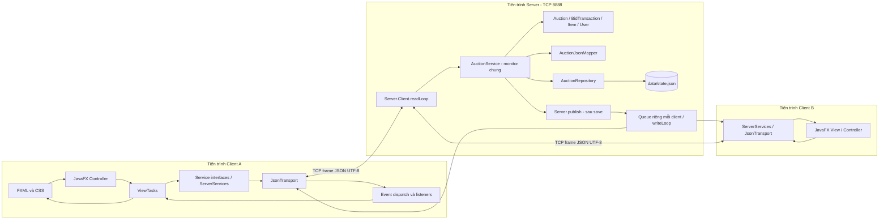
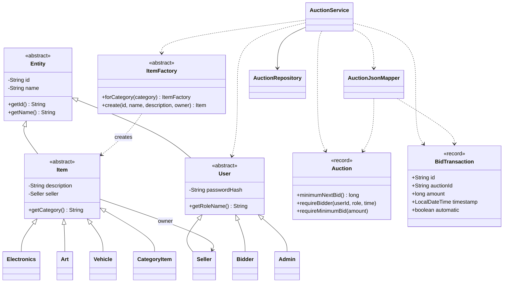
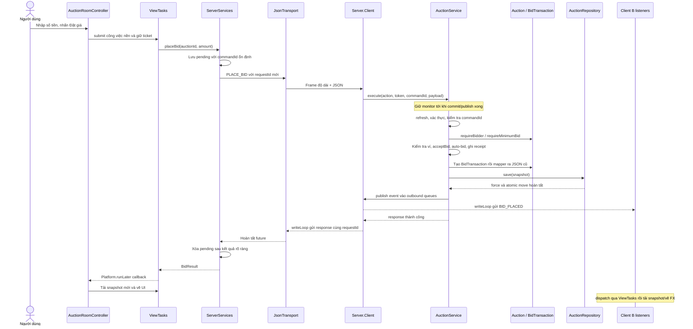

# Kiến trúc và luồng dữ liệu

Java release 25, JavaFX 26.0.2, Maven; một server TCP mặc định 8888, nhiều client.
Source chung trong một Maven project nhưng client/server là các tiến trình riêng.
JSON dùng cho cả thông điệp và snapshot, không có MySQL/JDBC/Spring/REST/WebSocket.

## Trách nhiệm các tầng

| Tầng | File/class | Trách nhiệm |
|---|---|---|
| View | `src/main/resources/com/auction/client/views/*.fxml`, `css/app.css` | Bố cục và kiểu hiển thị |
| Controller | `client/controller/*Controller` | Đọc form, trạng thái UI, gọi service nền, cập nhật UI |
| Model UI | `client/model/Auction`, Bid, User, Item | DTO để render, không phải nguồn dữ liệu chính thức |
| Service contract | `client/service/*Service` | Hợp đồng bid/ví/sản phẩm/admin, tách controller khỏi TCP |
| Adapter/network | ServerServices, ServerMapper, JsonTransport, JsonProtocol | Token, commandId, frame, pending request, push/reconnect |
| Request handler | `server/network/Server.Client.readLoop()` | Envelope, subscription, gọi service, ghép requestId |
| Application service | `server/service/AuctionService` | Xác thực/quyền, transaction, ví, auto-bid, settlement |
| Domain | `server/model/*` | Cây User/Item, luật Auction bất biến và bản ghi BidTransaction |
| Mapper | `server/dao/AuctionJsonMapper` | Đọc trường phiên, ghi bid đúng schema cũ, không sửa trường khác |
| Repository | `server/dao/AuctionRepository` | Load/save JSON, file lock, force và atomic move |

MVC phía server được ánh xạ như sau: readLoop là controller nhận request;
service + domain là model nghiệp vụ; repository là DAO; JSON response là biểu diễn
trả về. Không có JavaFX View trên server. Controller UI vẫn có kiểm tra định dạng,
khóa nút và báo giá tối thiểu để hỗ trợ người nhập; kiểm tra authoritative nằm ở
server. Không phát hiện controller ghi trực tiếp state.json của server.

## 1. Sơ đồ Client–Server



Không hiểu mũi tên ViewTasks → View là network thread sửa UI: nhánh trả kết quả
luôn được dispatch bằng Platform.runLater. Socket output chạy ở writer riêng.

## 2. Sơ đồ lớp OOP chính



Auction/BidTransaction ở đây là **server.model**, không phải DTO cùng tên ở client.
Record components là private final; dấu `+` trong diagram BidTransaction chỉ biểu
diễn accessor công khai. CategoryItem là nested private class của ItemFactory.
Service không giữ một collection Auction Java lâu dài; mapper dựng giá trị từ
snapshot trong transaction. Sơ đồ dùng dependency `..>` cho việc sử dụng tạm đó.

## 3. Sequence đặt giá



Sự kiện có thể đến trước ACK. Nếu save thất bại, service khôi phục `before`, xóa
events, trả STORAGE_ERROR; không có nhánh push thành công. Nếu cùng commandId đã
có receipt, trả kết quả cũ; không tạo lại BidTransaction. Với tiền tự động, có thể
có nhiều bid và nhiều event trong cùng một transaction.

## 4. Sequence hai client đặt cùng giá

```mermaid
sequenceDiagram
  participant A as Client A / reader A
  participant B as Client B / reader B
  participant S as AuctionService monitor
  participant R as AuctionRepository
  Note over A,B: Giá 1.000.000, bước 100.000, đủ tiền, không auto-bid
  par Gửi gần đồng thời
    A->>S: PLACE_BID 1.200.000 / commandA
  and
    B->>S: PLACE_BID 1.200.000 / commandB
  end
  Note over S: Giả sử A lấy monitor trước; thứ tự không được bảo đảm
  S->>S: A đọc mức tối thiểu 1.100.000, cập nhật giá 1.200.000
  S->>R: Lưu bid A, hold, receipt A
  R-->>S: Thành công
  S-->>A: Thành công; publish tới các subscriber
  Note over S: A nhả monitor; B mới được đọc và kiểm tra state
  S->>S: B thấy mức tối thiểu mới 1.300.000
  S->>S: Từ chối BID_TOO_LOW, ghi receipt REJECTED
  S->>R: Lưu receipt B, không thêm bid B
  R-->>S: Thành công
  S-->>B: BID_TOO_LOW
```

Nếu B lấy khóa trước thì vai trò đảo lại. Nếu A không lưu được, A bị rollback và
B có thể thành công; không được kết luận “luôn A thắng”. Người dẫn đầu hiện tại
chưa phải winner cuối cùng; scheduler quyết định settlement khi hết giờ.

## Snapshot và compatibility

SchemaVersion vẫn 1: users, auctions, rules, commands, transactions. Phiên cũ giữ
id/itemId/highestBidder/history/image/extension fields; bid mới giữ đúng các tên
`id`, `auctionId`, `bidderUsername`, `amount`, `timestamp`, `auto`. Repository vẫn
lưu cây JSON gốc. Mapper không tạo một snapshot mới chỉ từ bảy trường Auction,
nên không làm rơi lịch sử hoặc commandId.

Client chỉ lưu pending và cache ảnh dưới thư mục người dùng, không mở JSON server.
Session token chỉ ở RAM, restart cần đăng nhập lại. JSON là lựa chọn File I/O rõ
ràng cho quy mô bài tập; không thay thế transaction, lock hoặc kiểm thử.
